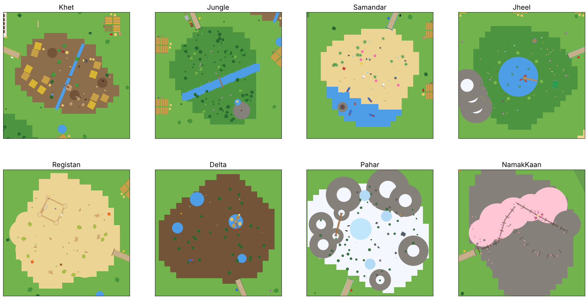

# Chai Chaos

A Roblox egg-hunting, collect-and-earn game set in a loud Pakistani bazaar. Eight havelis stand in a ring around the **Chowk**. Open your radar, follow a road through the countryside into one of **8 biomes**, grab an egg and get it home before it cracks. Eggs hatch into silly desi brainrots that fill your galla with rupees every second. Then other players try to steal them.

Every biome has its own landmark, plants and desi props, all modelled in Blender (see [3D models](#3d-models-blender)).

The original design is in [docs/game-design.md](docs/game-design.md). All 36 brainrots and their catchphrases come from it.


## How a round of play goes

1. **Spawn in your haveli.** Everyone starts with **Rs 1,000** and one incubator.
2. **Check the radar** (bottom right). It shows eggs near you, an **H** for home and a **C** for the Chowk. If no egg is in range, a pip on the edge points to the nearest one.
3. **Run out through a gate** into a biome. Further biomes have rarer brainrots, but their eggs crack sooner.
4. **Pick up an egg** (hold E). A timer starts. Hazards knock time off, and other players can bonk you with a chappal to make you drop it.
5. **Get it home.** Walk into your haveli and the egg goes into a free incubator. A little later it hatches, and the brainrot walks to a plot and starts earning.
6. **Spend your rupees at the Chowk:** better gear, a better radar, haveli upgrades, Kismat Rolls, and finally a **Naya Safar** (rebirth).

## Four ways to get a brainrot

1. **Eggs (the main way):** find them in the biomes and carry them home. What hatches depends on the biome.
2. **Kismat Roll (RNG):** roll at the Kismat Kettle with Rs 5,000 or a Kismat Roll. Rolls come free with daily chai and quests, and players can buy packs with Robux.
3. **Stealing:** grab someone else's brainrot and run it through your own door. Every steal uses a **Chor Pass** (bought with Robux; you get it back if the steal fails).
4. **Collection Book rewards:** finish a rarity to earn one of 6 special quest brainrots.

## The world

**The Chowk** is a round plaza with a fountain in the middle and everything you need around it:

| Stall | What it does |
| --- | --- |
| **BECHO (Sell)** | Opens the Brainrots window with Sell buttons. Sell any brainrot for half its value. |
| **GEAR SHOP** | Speed, egg, treasure and hazard gear (see below). |
| **RADAR WALA** | Tracker upgrades. |
| **KISMAT KETTLE** | Kismat Rolls, with the odds shown. |
| **NAYA SAFAR** | The rebirth gate. |
| **QUESTS** board | Daily quests and Collection Book rewards. |

There is also a chai dhaba with a charpai, parked rickshaws, a fruit cart, a leaderboard and string lights. Eight roads lead out between the havelis, each with a road sign by the Chowk and a bunting-covered gate at the biome.

**The countryside.** The biomes are separate zones with open countryside between them. Along the roads: milestones counting down to each biome, chai dhabas with charpais and a parked truck-art truck or rickshaw, bus stops, and fruit, pakora and gola ganda stalls near the gates. In the open land: little farms (wheat, sarson and sugarcane fields, a tube well, haystacks, tractors and mud houses), ponds with reeds, kikar and mango trees, rocks, street cricket and kites.

**The 8 biomes**, from closest to furthest:

| Tier | Biome | Landmark and details | Egg lasts | Hatches in | Best rarity | Hazards | Gear that helps |
| --- | --- | --- | --- | --- | --- | --- | --- |
| 1 | **Khet** (Punjab fields) | A **rehat** (Persian water wheel) on a canal; wheat and sarson fields, a village of mud houses with charpais, a tandoor, matkas, a tube well, the water tank, a tractor, haystacks, kites | 60 s | 15 s | Rare 5% | muddy rice paddies | Gum Boots |
| 2 | **Jungle** (forest and river) | A **treehouse** in a giant tree with a rope ladder, a **rope bridge** over the river, the waterfall cliff; banyan trees, bamboo, ferns, mossy rocks | 55 s | 25 s | Epic 3% | the river | Life Jacket |
| 3 | **Samandar** (Arabian Sea beach) | A striped **lighthouse** on the island; coconut palms, beach huts, colourful fishing boats, nets, umbrellas, a gola ganda cart | 51 s | 35 s | Legendary 2% | the sea, big waves | Life Jacket |
| 4 | **Jheel** (lake and meadows) | A **rest house** with a veranda and a long **jetty** with rowing boats; willows, poplars, reeds, lily pads, wild flowers, snowy peaks | 46 s | 45 s | Legendary 4% | the lake | Life Jacket |
| 5 | **Registan** (Cholistan desert) | An old **desert fort** with round towers, a gate, a well and stairs to the walls; dunes, tents, sandstone rocks, dry kikar trees, camels | 42 s | 55 s | Mythic 1% | sandstorms | Sand Goggles |
| 6 | **Delta** (Indus mangroves) | A **stilt fishing village** with walkways and a pier over its pool; mangroves, reeds, nets, boats | 37 s | 65 s | Mythic 2% | mud everywhere, pools | Gum Boots, Life Jacket |
| 7 | **Pahar** (Karakoram mountains) | A **suspension bridge** over the gorge between two ridges, a stone **mountain hut**; snowy deodars, junipers, a frozen lake | 33 s | 75 s | Mythic 4% | ice, flying snowballs | Snow Boots |
| 8 | **Namak Kaan** (pink salt caves) | The **mine entrance**, a mine-cart track with carts along the tunnel, timber supports, a crystal cavern with giant glowing crystals | 28 s | 85 s | Mythic 9% | darkness, falling salt | Lantern |



Each biome has its own egg colours, its own pool of brainrots (every brainrot hatches somewhere, and the Collection Book tells you where), at least two treasure chests, and a big title when you walk in.

## Eggs

- Each biome keeps 7 eggs lying around and refills them over time.
- **The timer:** an egg cracks when its time runs out. Standing in water or a sandstorm makes it crack twice as fast; waves, snowballs and falling salt knock 8 seconds off. Inside your own haveli the timer stops.
- **Incubators:** 1 at haveli level 1, 2 at level 3, 3 at level 5 and 4 at level 7. If they are all busy, keep holding your egg at home until one frees up. Eggs keep hatching while you are offline.
- **Golden eggs** (3%) sparkle, last a bit longer, are twice as lucky and always hatch a Golden, Diamond or Rainbow brainrot. Normal eggs hatch mutated about 5% of the time.
- **Egg rushes:** every 4 minutes one biome fills up with extra eggs for 60 seconds.
- You can carry one egg at a time. A chappal bonk makes you drop it, and anyone can grab it (with the time it had left). You cannot steal while holding an egg, or pick one up while carrying a stolen brainrot.

## The radar (Radar Wala)

| Level | Cost | Tracks eggs in | Range | Extras |
| --- | --- | --- | --- | --- |
| 1 | free | Khet | 150 | |
| 2 | Rs 2,500 | + Jungle | 180 | |
| 3 | Rs 8,000 | + Samandar | 210 | golden eggs |
| 4 | Rs 25,000 | + Jheel | 240 | golden eggs |
| 5 | Rs 70,000 | + Registan | 270 | golden eggs, treasure |
| 6 | Rs 160,000 | + Delta | 300 | golden eggs, treasure |
| 7 | Rs 320,000 | + Pahar | 340 | golden eggs, treasure |
| 8 | Rs 600,000 | + Namak Kaan | 400 | golden eggs, treasure |

Every biome is open from the start; the radar just helps you find things. The radar also shows the timer of the egg you carry, hazard warnings and egg rushes.

## Gear (Gear Shop)

Gear is bought once and kept forever, even after a Naya Safar. It works by itself.

| Gear | Cost | What it does |
| --- | --- | --- |
| Joggers | Rs 3,000 | Run 10% faster |
| Gum Boots | Rs 5,000 | No more getting stuck in mud |
| Padded Tokri | Rs 6,000 | Eggs last 25% longer |
| Life Jacket | Rs 8,000 | Swim fast, eggs safe from water and waves |
| Belcha (shovel) | Rs 20,000 | Dig up buried treasure |
| Sand Goggles | Rs 30,000 | See and run through sandstorms |
| Rassi Seedhi (rope ladder) | Rs 40,000 | Climb to treasure on cliffs, towers and stilt huts |
| Peshawari Chappal | Rs 60,000 | Run 25% faster |
| Thermos Dabba | Rs 80,000 | Eggs last 60% longer |
| Snow Boots | Rs 120,000 | No slipping on ice, snowballs miss you |
| Lantern | Rs 200,000 | Light up the salt caves, dodge falling salt |

## Riding

Open the **Brainrots** window (the button on the left) and press **Ride** on any brainrot. It leaves its plot and carries you everywhere, faster the rarer it is (Common +15%, Uncommon +25%, Rare +40%, Epic +60%, Legendary +80%, Mythic +110%, and a bit more for mutations). Your ride doesn't earn rupees; the rest stay home and farm. Press **Stop riding** and it walks back to a plot. Your ride is saved and comes back when you respawn or rejoin.

## Treasure

Every biome hides treasure chests. Buried ones (under a red X) need a **Belcha**; high ones need a **Rassi Seedhi** to climb up from the glowing spot: the Khet water tank's lid, the lighthouse gallery, a desert fort tower, a stilt-hut roof, rock pillars and a ledge in the salt cavern. A chest pays more in further biomes (Rs 1,500 times the tier squared) and sometimes a free Kismat Roll. Each player can open each chest once every 10 minutes.

## Havelis

- 8 big havelis with a courtyard, stairs, a second floor, a rooftop and incubator nests.
- **9 levels**, from 4 plots up to 20. Level 3 adds the **Laser Darwaza** (your Taala physically blocks the door, and anyone inside gets moved out). Level 4 adds a garden, level 5 opens the **second floor**, level 6 hires a **Chowkidar** who catches thieves, and level 8 adds a rooftop with chhatris and kites.
- **8 themes**, each with its own colours, decorations and a small perk: Mughal Marble (+5% income), Bagh Garden (thieves 15% slower), Truck Art (walk 12% faster), Chai Dhaba (cheaper Kismat Rolls), Sheesh Mahal (longer Taala), Basant Rooftop (mutations twice as likely in your rolls), Cricket Maidan (chappal reaches twice as far) and Mela Lights (+25% income during events). The first two are free; each Naya Safar unlocks the next.
- **Lockers:** plots 1 and 2 can never be robbed, and your two most valuable brainrots always move into them.
- **Galla:** every brainrot drops rupees into your galla each second. Walk into it to collect.

## Stealing and defending

- Hold E on someone else's brainrot. It rides on your back until you run through your own haveli door, and you walk slower the rarer it is.
- The owner gets a "Chor! Chor!" alert, and anyone can bonk the thief with their **Chappal**.
- **Fair-play rules:** a 15 second steal cooldown, no robbing the same haveli twice within 2 minutes, 3 minutes of protection after joining, and brainrots worth over Rs 16,000 can only be stolen by players who have rebirthed.
- **Taala (lock):** locks your haveli for 30 seconds, then needs 60 seconds to recharge.

## Progress

- **Naya Safar (rebirth)** at the gate in the Chowk: starts over your rupees, haveli level, radar, brainrots, eggs and ride, for +50% income forever and a new theme. You keep your gear, themes, Collection Book, Kismat Rolls and Chor Passes. The first costs Rs 1,000,000 and each one after costs 2.5 times more.
- **Daily quests:** 3 a day, like bringing eggs home from different biomes, hatching a Rare, a golden egg, opening treasure, upgrading your haveli or radar, collecting from your galla. They pay rupees and Kismat Rolls, plus 2 bonus rolls for finishing all three.
- **Collection Book:** fills in as you find brainrots and their mutations, and says which biomes each one hatches in. Finishing a rarity pays rupees and Kismat Rolls, plus that rarity's special quest brainrot.
- **Events** every 15-20 minutes, 5 minutes each. The banner shows the boosts:
  - **Basant Kite Festival:** kites fill the sky all around you. Cash x2, Luck x2.
  - **Baarish:** rain, twice as many eggs, +20% cash.
  - **Cricket Mania:** confetti, cash x1.5.
  - **Load Shedding:** night falls, Luck x3.
  - **Mela Night:** fireworks, eggs hatch twice as fast, Kismat Rolls 30% off.
  - **Sardi:** snow, eggs last 50% longer.
- **Daily chai:** a free brainrot or rupees, plus a free Kismat Roll, once a day.
- **Kismat Roll:** the odds for every rarity and mutation are shown before anyone rolls. An Epic or better is guaranteed at least every 30 rolls.
- **Robux packs:** 1 or 10 Kismat Rolls, and 1 or 5 Chor Passes. Purchases are saved straight away and never granted twice.
- **Saving** with DataStores: everything above, including eggs in incubators and your ride.

## Sounds

The game uses sounds that come with Roblox for buttons, coins, eggs (pick up, home, crack, hatch), treasure, bonks, the Chor alert, splashes, wind in the mountains and desert, upgrades, events and the Kismat Roll. They are all listed in [`src/shared/Sounds.luau`](src/shared/Sounds.luau).

There are three music slots, `MusicBazaar`, `MusicBiome` and `MusicEvent`, empty until you add your own: find a track in the Creator Store (Toolbox > Audio, try "dhol", "tabla" or "bazaar"), copy its id and paste it as `"rbxassetid://123456789"`. The right track plays for where you are. You can swap any other sound the same way, for example to add voice lines.

## 3D models (Blender)

All the landmarks, plants and props, and all 42 brainrots (see [The 42 brainrots](#the-42-brainrots)), are modelled in **Blender** with Python scripts in [`blender/`](blender/), in a chunky, low-poly, flat-colour style that runs well on phones. There are 74 props:

- **Landmarks:** rehat, treehouse, rope bridge, lighthouse, rest house, jetty, desert fort, stilt village, suspension bridge, mountain hut, crystal cluster, mine entrance, mine track, mine cart, cave support.
- **Plants and nature:** kikar (green and dry), mango, banyan, jungle tree, bamboo, bushes, ferns, coconut palm, willow, poplar, deodar (green and snowy), mangrove, juniper, desert shrub, dune grass, reeds, wild flowers, lily pads, boulders, mossy, snowy and beach rocks, sandstone rocks, salt crystals, stalagmites, wheat, sarson and sugarcane fields.
- **Desi props:** charpai, milestone, matkas, tube well, chai dhaba, fruit stall, pakora stall, gola ganda cart, truck-art truck, auto rickshaw, tractor and trolley, bus stop, road sign, tandoor, haystack, mud house, water tank, beach huts, fishing boat, rowing boat, net rack, desert tent, beach umbrella, lamp post, kite line, bench, street cricket.

| Landmarks | Plants and nature | Desi props |
| --- | --- | --- |
|  |  |  |

**How the game uses them.** `blender/build.py` turns every model into two things:

1. **Roblox parts** in [`src/server/PropData.luau`](src/server/PropData.luau). The game builds every prop out of parts by itself, so it all works with no importing.
2. **Meshes** in [`assets/props/ChaiChaosProps.fbx`](assets/props/ChaiChaosProps.fbx): one smoother mesh per prop and per brainrot, all coloured from one small palette texture. If you import them, the game uses them instead of the parts and keeps the parts as invisible walls, so you can still walk on the bridges, jetty and decks. Glowing and see-through pieces (lamps, crystals, glass) always stay parts. Golden, Diamond and Rainbow brainrots always use parts, so they can be tinted while their eyes keep their colour.

**Importing the meshes into Studio (optional, once):**

1. Make sure you are logged in to Studio: the importer uploads the meshes to your account.
2. **File > Import 3D**, pick `assets/props/ChaiChaosProps.fbx` and import it. It comes in as one model with 116 meshes, each named after its prop or brainrot (`Rehat`, `Lighthouse`, `KikarTree`, `SamosaSupremo`...).
3. Rename that model to **`ChaiChaosProps`** and drag it into **ServerStorage**.
4. Press Play. Every prop and brainrot that has a matching mesh uses it.

The game resizes each mesh to the right size and stands it up if the importer laid it on its side. If every mesh faces backwards, set `Config.PROP_MESH_TURN = 180`.

**Changing the models.** Open [`assets/props/ChaiChaosProps.blend`](assets/props/ChaiChaosProps.blend) in Blender to look at everything. To change a prop, edit its Python in `blender/props_landmarks.py`, `props_plants.py` or `props_desi.py`; the brainrots are in `brainrots_a.py` (Common and Uncommon), `brainrots_b.py` (Rare and Epic) and `brainrots_c.py` (Legendary, Mythic and Special). The helpers are in `blender/kit.py` and `blender/brainrot_kit.py` (eyes, smiles, moustaches, arms, legs, crowns, caps, wings). Then rebuild everything:

```bash
pip install bpy==5.2.3          # Blender as a Python module (needs Python 3.13)
python blender/build.py         # writes PropData.luau, the FBX, the .blend, the previews and the character sheets
```

Where each prop goes in the world is in [`BiomeBuilder.luau`](src/server/BiomeBuilder.luau) (the biomes) and [`MapBuilder.luau`](src/server/MapBuilder.luau) (the Chowk and the countryside).

## The 42 brainrots

Every brainrot has a chunky, cute Blender model with big eyes, in the same flat-colour style as the props. The game builds it from parts by itself (or uses its mesh if you imported the FBX). It is shrunk if needed so it always fits on an 8 x 8 plot. If you make your own model for a brainrot, the game uses yours instead (see [Making it yours](#making-it-yours)).

Each character sheet below has:

- **Look and personality:** what it looks like and how it acts.
- **Colour palette:** the exact colours of the Blender model, as hex codes.
- **A ready-to-paste prompt:** copy it into ChatGPT Astra (or any image or 3D generator) to get a detailed picture or model of the character in the same style. Paste the same prompt again and ask for "the same character from the side and the back" to get a turnaround.
- **In the game:** its id, price, income, size and where it hatches.

Click a name to open its sheet. The pictures are the Blender models, one per rarity.

<!-- characters:start -->
<!-- Generated by blender/characters.py from its own text and the game's data files. Edit it there. -->

#### Common (8)


<details>
<summary><b>Gol Gappa Ghostu</b> · Common · <i>"Thora aur khatta daalo!"</i></summary>

**Look and personality.** A crispy golden gol gappa puri who floats around like a friendly little ghost. Its bottom melts into a wavy tail of tangy tamarind water, and a few chickpeas peek out of the hole on top. Always leaking a little, always asking for more khatta.

**Colour palette**

| Part | Hex |
| --- | --- |
| Puri gold | `#E2AA50` |
| Crispy edge | `#BE7D37` |
| Imli pani | `#968C3C` |
| Chickpea | `#E1C378` |
| Blush | `#FF96A0` |

**Ready-to-paste prompt (ChatGPT Astra or any image or 3D generator)**

```text
Create a 3D cartoon character for my kid-friendly Roblox game "Chai Chaos", a funny game about Pakistani street food, bazaars and family life.

Character: Gol Gappa Ghostu. A round, hollow golden puri (gol gappa) that floats like a cute ghost. Its lower half melts into a wavy, see-through tail of brown tamarind water with drips falling off. A hole on top with three chickpeas peeking out. Big eyes, rosy cheeks and a small open 'ooh' mouth with its tongue out. Floating a little above the ground.

Style: chunky and cute, low-poly with flat colours (no textures, no gradients), soft rounded toy-like shapes, big round cartoon eyes (white with a black pupil and a small white shine), friendly and funny, made for kids.

Colours: puri gold #E2AA50, crispy edge #BE7D37, imli pani #968C3C, chickpea #E1C378, blush #FF96A0.

Show one character only, full body, front three-quarter view, on a plain white background with soft light. No text, no logos, no real brands.

If you can make a 3D model: a game-ready low-poly mesh (under 10,000 triangles), flat colours, facing forward, standing with its base on the ground, about 4.0 studs tall.
```

**In the game:** id `GolGappaGhostu` · Rs 50 · +Rs 1/s · 4.0 studs tall, 2.8 x 3.0 studs wide, floats · Hatches in Samandar (Arabian Sea Beach), Jheel (Lake and Meadows).

</details>

<details>
<summary><b>Chana Chaat Chacha</b> · Common · <i>"Imli wali, imli wali!"</i></summary>

**Look and personality.** A friendly old uncle made from a steel bowl of chana chaat, full of chickpeas, onion, tomato and coriander. His moustache is crunchy yellow sev and he walks with a spoon as a walking stick. Always shouting about imli.

**Colour palette**

| Part | Hex |
| --- | --- |
| Steel bowl | `#C8CDD4` |
| Chickpea | `#E1C378` |
| Sev moustache | `#F0BE46` |
| Tomato | `#DC3C28` |
| Onion | `#A53C78` |
| Coriander | `#3C9632` |

**Ready-to-paste prompt (ChatGPT Astra or any image or 3D generator)**

```text
Create a 3D cartoon character for my kid-friendly Roblox game "Chai Chaos", a funny game about Pakistani street food, bazaars and family life.

Character: Chana Chaat Chacha. A round steel bowl (katori) filled to the top with chana chaat: chickpeas, red onion, tomato and green coriander. The bowl itself is the face of a kind old uncle with big eyes and a bushy moustache made of crunchy yellow sev. Tiny legs and little black shoes. He leans on a long steel spoon like a walking stick.

Style: chunky and cute, low-poly with flat colours (no textures, no gradients), soft rounded toy-like shapes, big round cartoon eyes (white with a black pupil and a small white shine), friendly and funny, made for kids.

Colours: steel bowl #C8CDD4, chickpea #E1C378, sev moustache #F0BE46, tomato #DC3C28, onion #A53C78, coriander #3C9632.

Show one character only, full body, front three-quarter view, on a plain white background with soft light. No text, no logos, no real brands.

If you can make a 3D model: a game-ready low-poly mesh (under 10,000 triangles), flat colours, facing forward, standing with its base on the ground, about 2.7 studs tall.
```

**In the game:** id `ChanaChaatChacha` · Rs 80 · +Rs 2/s · 2.7 studs tall, 3.6 x 3.5 studs wide · Hatches in Khet (Punjab Fields).

</details>

<details>
<summary><b>Samosa Supremo</b> · Common · <i>"Main course main hoon!"</i></summary>

**Look and personality.** The coolest snack in the bazaar. A golden triangle samosa in black shades who stands on a white plate like it is a stage, little arms crossed. It never smiles much, because the main course does not need to.

**Colour palette**

| Part | Hex |
| --- | --- |
| Samosa gold | `#D79646` |
| Crispy brown | `#AF6E2D` |
| Shades | `#232328` |
| Plate | `#FAFAFA` |

**Ready-to-paste prompt (ChatGPT Astra or any image or 3D generator)**

```text
Create a 3D cartoon character for my kid-friendly Roblox game "Chai Chaos", a funny game about Pakistani street food, bazaars and family life.

Character: Samosa Supremo. A big golden-brown triangular samosa with crimped, crispy edges and little flaky bumps. It wears dark rectangular sunglasses, has tiny arms crossed in front, a small confident smirk, and stands on a round white plate like a stage. Short stubby legs.

Style: chunky and cute, low-poly with flat colours (no textures, no gradients), soft rounded toy-like shapes, big round cartoon eyes (white with a black pupil and a small white shine), friendly and funny, made for kids.

Colours: samosa gold #D79646, crispy brown #AF6E2D, shades #232328, plate #FAFAFA.

Show one character only, full body, front three-quarter view, on a plain white background with soft light. No text, no logos, no real brands.

If you can make a 3D model: a game-ready low-poly mesh (under 10,000 triangles), flat colours, facing forward, standing with its base on the ground, about 3.4 studs tall.
```

**In the game:** id `SamosaSupremo` · Rs 100 · +Rs 2/s · 3.4 studs tall, 3.8 x 3.8 studs wide · Hatches in Khet (Punjab Fields), Registan (Cholistan Desert).

</details>

<details>
<summary><b>Naan Ninja</b> · Common · <i>"Roti star! Hiyaa!"</i></summary>

**Look and personality.** A soft teardrop naan with char spots who thinks it is a ninja. Black headband, black mask, and it throws tiny roti stars. Hiyaa!

**Colour palette**

| Part | Hex |
| --- | --- |
| Naan | `#EECD91` |
| Char spots | `#966437` |
| Headband | `#232328` |
| Roti star | `#FAEBC8` |

**Ready-to-paste prompt (ChatGPT Astra or any image or 3D generator)**

```text
Create a 3D cartoon character for my kid-friendly Roblox game "Chai Chaos", a funny game about Pakistani street food, bazaars and family life.

Character: Naan Ninja. A teardrop-shaped naan bread standing up, pale golden with dark char spots. It wears a black ninja headband with long tails flowing behind and a black mask strip across its eyes. Tiny arms and legs in an action pose, throwing a little round roti shaped like a ninja star.

Style: chunky and cute, low-poly with flat colours (no textures, no gradients), soft rounded toy-like shapes, big round cartoon eyes (white with a black pupil and a small white shine), friendly and funny, made for kids.

Colours: naan #EECD91, char spots #966437, headband #232328, roti star #FAEBC8.

Show one character only, full body, front three-quarter view, on a plain white background with soft light. No text, no logos, no real brands.

If you can make a 3D model: a game-ready low-poly mesh (under 10,000 triangles), flat colours, facing forward, standing with its base on the ground, about 3.9 studs tall.
```

**In the game:** id `NaanNinja` · Rs 120 · +Rs 2/s · 3.9 studs tall, 3.5 x 1.4 studs wide · Hatches in Khet (Punjab Fields).

</details>

<details>
<summary><b>Kulfi Kangaroo</b> · Common · <i>"Pighla... phir jam gaya!"</i></summary>

**Look and personality.** A pistachio-and-cream kulfi on its stick who hops around like a kangaroo, with long ears and big feet. It melts a little in the sun, then freezes again. Very bouncy, a bit drippy.

**Colour palette**

| Part | Hex |
| --- | --- |
| Kulfi cream | `#F5E8BE` |
| Pistachio | `#AACD78` |
| Stick | `#CDA56E` |
| Ice drips | `#78BEFF` |
| Blush | `#FF96A0` |

**Ready-to-paste prompt (ChatGPT Astra or any image or 3D generator)**

```text
Create a 3D cartoon character for my kid-friendly Roblox game "Chai Chaos", a funny game about Pakistani street food, bazaars and family life.

Character: Kulfi Kangaroo. A cone-shaped kulfi ice cream on a wooden stick, cream coloured with a green pistachio top sprinkled with nuts. It has long kangaroo ears with pink insides, big kangaroo feet, tiny arms and a happy smile. A few icy blue drips on its sides. Mid-hop, bouncing on its stick like a pogo tail.

Style: chunky and cute, low-poly with flat colours (no textures, no gradients), soft rounded toy-like shapes, big round cartoon eyes (white with a black pupil and a small white shine), friendly and funny, made for kids.

Colours: kulfi cream #F5E8BE, pistachio #AACD78, stick #CDA56E, ice drips #78BEFF, blush #FF96A0.

Show one character only, full body, front three-quarter view, on a plain white background with soft light. No text, no logos, no real brands.

If you can make a 3D model: a game-ready low-poly mesh (under 10,000 triangles), flat colours, facing forward, standing with its base on the ground, about 5.0 studs tall.
```

**In the game:** id `KulfiKangaroo` · Rs 150 · +Rs 3/s · 5.0 studs tall, 2.0 x 2.3 studs wide · Hatches in Jungle (Forest and River), Jheel (Lake and Meadows).

</details>

<details>
<summary><b>Pyaaz Pehelwan</b> · Common · <i>"Ro kyun rahe ho?"</i></summary>

**Look and personality.** A big purple onion who is a champion wrestler. Strong arms, a curly moustache, green sprouts for hair, wrestling shorts and a gold champion belt. He makes everyone cry, but only because he is an onion.

**Colour palette**

| Part | Hex |
| --- | --- |
| Onion | `#A53C78` |
| Onion skin | `#E1AFCD` |
| Sprouts | `#3C9632` |
| Shorts | `#DC3232` |
| Champion belt | `#F0BE3C` |
| Moustache | `#232328` |

**Ready-to-paste prompt (ChatGPT Astra or any image or 3D generator)**

```text
Create a 3D cartoon character for my kid-friendly Roblox game "Chai Chaos", a funny game about Pakistani street food, bazaars and family life.

Character: Pyaaz Pehelwan. A big round purple onion with thin pale layer lines, green sprouts on top like hair, a thick curly black moustache and determined eyebrows. Strong flexing arms, red wrestling shorts with a shiny gold champion belt, short legs. Tiny tear drops fly off to the sides. A proud wrestler pose.

Style: chunky and cute, low-poly with flat colours (no textures, no gradients), soft rounded toy-like shapes, big round cartoon eyes (white with a black pupil and a small white shine), friendly and funny, made for kids.

Colours: onion #A53C78, onion skin #E1AFCD, sprouts #3C9632, shorts #DC3232, champion belt #F0BE3C, moustache #232328.

Show one character only, full body, front three-quarter view, on a plain white background with soft light. No text, no logos, no real brands.

If you can make a 3D model: a game-ready low-poly mesh (under 10,000 triangles), flat colours, facing forward, standing with its base on the ground, about 4.2 studs tall.
```

**In the game:** id `PyaazPehelwan` · Rs 180 · +Rs 4/s · 4.2 studs tall, 4.8 x 2.9 studs wide · Hatches in Khet (Punjab Fields), Registan (Cholistan Desert).

</details>

<details>
<summary><b>Chaiyoo Kettlesaurus</b> · Common · <i>"Doodh patti, extra cheeni."</i></summary>

**Look and personality.** A shiny steel chai kettle that grew into a tiny dinosaur. The spout is its long neck and head, the lid is its hat and the handle is its tail. It roars puffs of steam and only drinks doodh patti with extra cheeni.

**Colour palette**

| Part | Hex |
| --- | --- |
| Steel | `#C8CDD4` |
| Dark steel | `#8C919B` |
| Lid knob | `#232328` |
| Steam | `#F0F0F5` |

**Ready-to-paste prompt (ChatGPT Astra or any image or 3D generator)**

```text
Create a 3D cartoon character for my kid-friendly Roblox game "Chai Chaos", a funny game about Pakistani street food, bazaars and family life.

Character: Chaiyoo Kettlesaurus. A round, shiny steel chai kettle shaped like a small dinosaur: the curved spout is a long neck ending in a cute dino head, the lid sits on top like a hat with a black knob, and the black handle curls out the back like a tail. Four stubby dark-steel legs. Big eyes on the head, a happy open mouth roaring little white puffs of steam.

Style: chunky and cute, low-poly with flat colours (no textures, no gradients), soft rounded toy-like shapes, big round cartoon eyes (white with a black pupil and a small white shine), friendly and funny, made for kids.

Colours: steel #C8CDD4, dark steel #8C919B, lid knob #232328, steam #F0F0F5.

Show one character only, full body, front three-quarter view, on a plain white background with soft light. No text, no logos, no real brands.

If you can make a 3D model: a game-ready low-poly mesh (under 10,000 triangles), flat colours, facing forward, standing with its base on the ground, about 4.3 studs tall.
```

**In the game:** id `ChaiyooKettlesaurus` · Rs 200 · +Rs 4/s · 4.3 studs tall, 2.5 x 5.8 studs wide · Hatches in Samandar (Arabian Sea Beach), Delta (Indus Mangroves).

</details>

<details>
<summary><b>Pakora Panda</b> · Common · <i>"Baarish? Pakora time!"</i></summary>

**Look and personality.** A lumpy, crispy golden pakora shaped like a panda, with dark crispy patches for ears and eye patches. When it rains it opens a tiny umbrella and sits on its paper plate with a dab of green chutney.

**Colour palette**

| Part | Hex |
| --- | --- |
| Pakora gold | `#C38232` |
| Crispy patches | `#6E411E` |
| Umbrella | `#326EDC` |
| Paper plate | `#FAFAFA` |
| Chutney | `#3CA03C` |

**Ready-to-paste prompt (ChatGPT Astra or any image or 3D generator)**

```text
Create a 3D cartoon character for my kid-friendly Roblox game "Chai Chaos", a funny game about Pakistani street food, bazaars and family life.

Character: Pakora Panda. A round, lumpy, golden fried pakora shaped like a chubby panda: dark crispy brown ears, eye patches and paws. It holds a tiny blue umbrella with a white top and sits on a white paper plate with a blob of green chutney beside it. Big shiny eyes, a happy little mouth.

Style: chunky and cute, low-poly with flat colours (no textures, no gradients), soft rounded toy-like shapes, big round cartoon eyes (white with a black pupil and a small white shine), friendly and funny, made for kids.

Colours: pakora gold #C38232, crispy patches #6E411E, umbrella #326EDC, paper plate #FAFAFA, chutney #3CA03C.

Show one character only, full body, front three-quarter view, on a plain white background with soft light. No text, no logos, no real brands.

If you can make a 3D model: a game-ready low-poly mesh (under 10,000 triangles), flat colours, facing forward, standing with its base on the ground, about 4.3 studs tall.
```

**In the game:** id `PakoraPanda` · Rs 240 · +Rs 5/s · 4.3 studs tall, 4.4 x 3.6 studs wide · Hatches in Jungle (Forest and River), Delta (Indus Mangroves).

</details>

#### Uncommon (7)


<details>
<summary><b>Paratha Pilot</b> · Uncommon · <i>"Ghee landing in 3... 2... 1!"</i></summary>

**Look and personality.** A flaky round paratha who flies like a plane, with aviator goggles, a leather pilot cap and a scarf flapping behind. Drips of ghee fall when it comes in to land. Ghee landing in 3... 2... 1!

**Colour palette**

| Part | Hex |
| --- | --- |
| Paratha | `#E1B96E` |
| Ghee | `#FFD75A` |
| Pilot cap | `#82502D` |
| Scarf | `#FAFAFA` |
| Goggle lenses | `#78BEFF` |

**Ready-to-paste prompt (ChatGPT Astra or any image or 3D generator)**

```text
Create a 3D cartoon character for my kid-friendly Roblox game "Chai Chaos", a funny game about Pakistani street food, bazaars and family life.

Character: Paratha Pilot. A round, flaky, golden paratha standing on its edge like a flying disc, with swirly layer lines. It wears brown aviator goggles over big eyes, a brown leather pilot cap on top and a white scarf flapping behind. Shiny ghee drips on its edge. A surprised 'o' mouth. Flying, tilted as if banking a turn.

Style: chunky and cute, low-poly with flat colours (no textures, no gradients), soft rounded toy-like shapes, big round cartoon eyes (white with a black pupil and a small white shine), friendly and funny, made for kids.

Colours: paratha #E1B96E, ghee #FFD75A, pilot cap #82502D, scarf #FAFAFA, goggle lenses #78BEFF.

Show one character only, full body, front three-quarter view, on a plain white background with soft light. No text, no logos, no real brands.

If you can make a 3D model: a game-ready low-poly mesh (under 10,000 triangles), flat colours, facing forward, standing with its base on the ground, about 4.1 studs tall.
```

**In the game:** id `ParathaPilot` · Rs 600 · +Rs 10/s · 4.1 studs tall, 3.7 x 4.0 studs wide, floats · Hatches in Jungle (Forest and River), Jheel (Lake and Meadows).

</details>

<details>
<summary><b>Lassi Llama</b> · Uncommon · <i>"Malai moochh, full style!"</i></summary>

**Look and personality.** A fluffy beige llama sitting in a tall glass of sweet lassi, with a white malai moustache and froth on its head. A red straw sticks out beside it. Very stylish, very creamy.

**Colour palette**

| Part | Hex |
| --- | --- |
| Llama wool | `#E8CDA5` |
| Lassi | `#F0F5EB` |
| Malai | `#FFFAE6` |
| Glass | `#B4DCFF` |
| Straw | `#DC3232` |

**Ready-to-paste prompt (ChatGPT Astra or any image or 3D generator)**

```text
Create a 3D cartoon character for my kid-friendly Roblox game "Chai Chaos", a funny game about Pakistani street food, bazaars and family life.

Character: Lassi Llama. A fluffy beige llama with tall ears sitting inside a tall clear glass full of white lassi, only its head, neck and front hooves showing over the rim. A thick white malai moustache, froth on top of its head, rosy cheeks, a red straw in the glass. Big happy eyes.

Style: chunky and cute, low-poly with flat colours (no textures, no gradients), soft rounded toy-like shapes, big round cartoon eyes (white with a black pupil and a small white shine), friendly and funny, made for kids.

Colours: llama wool #E8CDA5, lassi #F0F5EB, malai #FFFAE6, glass #B4DCFF, straw #DC3232.

Show one character only, full body, front three-quarter view, on a plain white background with soft light. No text, no logos, no real brands.

If you can make a 3D model: a game-ready low-poly mesh (under 10,000 triangles), flat colours, facing forward, standing with its base on the ground, about 4.7 studs tall.
```

**In the game:** id `LassiLlama` · Rs 800 · +Rs 13/s · 4.7 studs tall, 2.3 x 2.4 studs wide · Hatches in Khet (Punjab Fields), Jheel (Lake and Meadows).

</details>

<details>
<summary><b>Gajar Halwa Gorilla</b> · Uncommon · <i>"Sardi aa gayi!"</i></summary>

**Look and personality.** A big cuddly gorilla made of grainy orange gajar halwa, sprinkled with almonds and pistachios. He wears a woolly scarf and a shawl because winter is here, and carries a steaming bowl of halwa to share.

**Colour palette**

| Part | Hex |
| --- | --- |
| Gajar halwa | `#F07323` |
| Almonds | `#E6C8A0` |
| Pistachio | `#AACD78` |
| Scarf | `#326EDC` |
| Shawl | `#821E32` |
| Bowl | `#C8CDD4` |

**Ready-to-paste prompt (ChatGPT Astra or any image or 3D generator)**

```text
Create a 3D cartoon character for my kid-friendly Roblox game "Chai Chaos", a funny game about Pakistani street food, bazaars and family life.

Character: Gajar Halwa Gorilla. A big, chubby gorilla made of grainy orange carrot halwa with little almond and pistachio pieces on it. A blue woolly scarf around his neck and a maroon shawl over his shoulders. He holds a steel bowl of steaming halwa. Big kind eyes, a gentle smile, long arms, short legs.

Style: chunky and cute, low-poly with flat colours (no textures, no gradients), soft rounded toy-like shapes, big round cartoon eyes (white with a black pupil and a small white shine), friendly and funny, made for kids.

Colours: gajar halwa #F07323, almonds #E6C8A0, pistachio #AACD78, scarf #326EDC, shawl #821E32, bowl #C8CDD4.

Show one character only, full body, front three-quarter view, on a plain white background with soft light. No text, no logos, no real brands.

If you can make a 3D model: a game-ready low-poly mesh (under 10,000 triangles), flat colours, facing forward, standing with its base on the ground, about 4.1 studs tall.
```

**In the game:** id `GajarHalwaGorilla` · Rs 1,000 · +Rs 15/s · 4.1 studs tall, 4.0 x 2.9 studs wide · Hatches in Registan (Cholistan Desert), Pahar (Karakoram Mountains).

</details>

<details>
<summary><b>Rickshaw Raptor</b> · Uncommon · <i>"Pon pon! Kahan jaana hai?"</i></summary>

**Look and personality.** A green-and-yellow auto rickshaw on raptor legs, with headlight eyes, a grille full of teeth and a dino tail. Pon pon! It always asks where you want to go and never takes the short way.

**Colour palette**

| Part | Hex |
| --- | --- |
| Rickshaw green | `#289646` |
| Yellow trim | `#FFCD28` |
| Canopy | `#232328` |
| Raptor feet | `#28A050` |
| Teeth | `#FAFAFA` |

**Ready-to-paste prompt (ChatGPT Astra or any image or 3D generator)**

```text
Create a 3D cartoon character for my kid-friendly Roblox game "Chai Chaos", a funny game about Pakistani street food, bazaars and family life.

Character: Rickshaw Raptor. A small green auto rickshaw with a yellow stripe and a black canopy roof, walking on two strong raptor dinosaur legs with claws. The headlights are big cartoon eyes and the front grille is a wide grin with square white teeth. A green dino tail sticks out the back. Leaning forward like it is running.

Style: chunky and cute, low-poly with flat colours (no textures, no gradients), soft rounded toy-like shapes, big round cartoon eyes (white with a black pupil and a small white shine), friendly and funny, made for kids.

Colours: rickshaw green #289646, yellow trim #FFCD28, canopy #232328, raptor feet #28A050, teeth #FAFAFA.

Show one character only, full body, front three-quarter view, on a plain white background with soft light. No text, no logos, no real brands.

If you can make a 3D model: a game-ready low-poly mesh (under 10,000 triangles), flat colours, facing forward, standing with its base on the ground, about 4.1 studs tall.
```

**In the game:** id `RickshawRaptor` · Rs 1,200 · +Rs 18/s · 4.1 studs tall, 2.4 x 6.4 studs wide · Hatches in Jungle (Forest and River), Registan (Cholistan Desert).

</details>

<details>
<summary><b>Bun Kebab Bhai</b> · Uncommon · <i>"Ek dum garam!"</i></summary>

**Look and personality.** A bun kebab who works out. He stands on a little stage flexing his big arms, holding up a gold trophy, with a sweatband on his bun. Ek dum garam!

**Colour palette**

| Part | Hex |
| --- | --- |
| Bun | `#CD8C46` |
| Kebab | `#7D4628` |
| Egg | `#FAD250` |
| Lettuce | `#28A050` |
| Sweatband | `#DC3232` |
| Trophy | `#F0BE3C` |

**Ready-to-paste prompt (ChatGPT Astra or any image or 3D generator)**

```text
Create a 3D cartoon character for my kid-friendly Roblox game "Chai Chaos", a funny game about Pakistani street food, bazaars and family life.

Character: Bun Kebab Bhai. A bun kebab burger (soft bun, brown kebab patty, egg layer and green lettuce) with a face and a proud smile. Big muscly arms: one flexing, one holding up a shiny gold trophy. A red sweatband on the top bun with sesame seeds. Standing on a small yellow-and-red stage like a bodybuilding show.

Style: chunky and cute, low-poly with flat colours (no textures, no gradients), soft rounded toy-like shapes, big round cartoon eyes (white with a black pupil and a small white shine), friendly and funny, made for kids.

Colours: bun #CD8C46, kebab #7D4628, egg #FAD250, lettuce #28A050, sweatband #DC3232, trophy #F0BE3C.

Show one character only, full body, front three-quarter view, on a plain white background with soft light. No text, no logos, no real brands.

If you can make a 3D model: a game-ready low-poly mesh (under 10,000 triangles), flat colours, facing forward, standing with its base on the ground, about 3.8 studs tall.
```

**In the game:** id `BunKebabBhai` · Rs 1,600 · +Rs 24/s · 3.8 studs tall, 4.3 x 2.7 studs wide · Hatches in Khet (Punjab Fields), Delta (Indus Mangroves).

</details>

<details>
<summary><b>Doodh Patti Dolphin</b> · Uncommon · <i>"Chai mein chhalaang!"</i></summary>

**Look and personality.** A milky-brown dolphin leaping out of a clay kulhad of doodh patti chai, splashing chai in an arc. Warm, playful and always steaming.

**Colour palette**

| Part | Hex |
| --- | --- |
| Doodh patti | `#B9875F` |
| Belly | `#FFF0CD` |
| Kulhad clay | `#BE6941` |
| Chai | `#B47846` |
| Steam | `#F0F0F5` |

**Ready-to-paste prompt (ChatGPT Astra or any image or 3D generator)**

```text
Create a 3D cartoon character for my kid-friendly Roblox game "Chai Chaos", a funny game about Pakistani street food, bazaars and family life.

Character: Doodh Patti Dolphin. A chubby milky-brown dolphin with a cream belly leaping out of a small clay cup (kulhad) full of tea, its body curved in a happy arc. Drops of chai splash in an arc behind it and white steam rises from the cup. Big eyes, rosy cheeks, a wide smile.

Style: chunky and cute, low-poly with flat colours (no textures, no gradients), soft rounded toy-like shapes, big round cartoon eyes (white with a black pupil and a small white shine), friendly and funny, made for kids.

Colours: doodh patti #B9875F, belly #FFF0CD, kulhad clay #BE6941, chai #B47846, steam #F0F0F5.

Show one character only, full body, front three-quarter view, on a plain white background with soft light. No text, no logos, no real brands.

If you can make a 3D model: a game-ready low-poly mesh (under 10,000 triangles), flat colours, facing forward, standing with its base on the ground, about 4.1 studs tall.
```

**In the game:** id `DoodhPattiDolphin` · Rs 1,800 · +Rs 26/s · 4.1 studs tall, 4.2 x 3.2 studs wide, floats · Hatches in Samandar (Arabian Sea Beach), Delta (Indus Mangroves).

</details>

<details>
<summary><b>Rooh Afza Rhino</b> · Uncommon · <i>"Sab kuch pink!"</i></summary>

**Look and personality.** A glossy red rhino shaped like a bottle of rose sharbat. Its horn is the bottle neck with a gold cap, and see-through windows on its sides show the pink drink inside. Rose petals float around it. Everything is pink! (A made-up sharbat, no real brand.)

**Colour palette**

| Part | Hex |
| --- | --- |
| Bottle red | `#D71E37` |
| Pink sharbat | `#FF6E96` |
| Rose petals | `#DC2850` |
| Cap | `#F0BE3C` |

**Ready-to-paste prompt (ChatGPT Astra or any image or 3D generator)**

```text
Create a 3D cartoon character for my kid-friendly Roblox game "Chai Chaos", a funny game about Pakistani street food, bazaars and family life.

Character: Rooh Afza Rhino. A chubby, glossy red rhino shaped like a glass sharbat bottle. Its horn is a bottle neck with a little gold cap. See-through windows on its sides show bright pink rose drink sloshing inside. Short thick legs, a small tail, big friendly eyes and a smile. Pink rose petals floating around it. No labels or brand names.

Style: chunky and cute, low-poly with flat colours (no textures, no gradients), soft rounded toy-like shapes, big round cartoon eyes (white with a black pupil and a small white shine), friendly and funny, made for kids.

Colours: bottle red #D71E37, pink sharbat #FF6E96, rose petals #DC2850, cap #F0BE3C.

Show one character only, full body, front three-quarter view, on a plain white background with soft light. No text, no logos, no real brands.

If you can make a 3D model: a game-ready low-poly mesh (under 10,000 triangles), flat colours, facing forward, standing with its base on the ground, about 3.3 studs tall.
```

**In the game:** id `RoohAfzaRhino` · Rs 2,000 · +Rs 30/s · 3.3 studs tall, 3.2 x 5.5 studs wide · Hatches in Samandar (Arabian Sea Beach), Pahar (Karakoram Mountains).

</details>

#### Rare (6)


<details>
<summary><b>Load Shedding Lattoo</b> · Rare · <i>"Light aa gayi!"</i></summary>

**Look and personality.** A spinning top (lattoo) with red and yellow stripes and a light bulb for a head. When the power goes, its eyes switch off; when it comes back, it lights up and shouts 'Light aa gayi!'

**Colour palette**

| Part | Hex |
| --- | --- |
| Stripe red | `#DC3232` |
| Stripe yellow | `#FFCD28` |
| Bulb | `#FFF096` |
| Wooden tip | `#96643C` |
| String | `#C8AF82` |

**Ready-to-paste prompt (ChatGPT Astra or any image or 3D generator)**

```text
Create a 3D cartoon character for my kid-friendly Roblox game "Chai Chaos", a funny game about Pakistani street food, bazaars and family life.

Character: Load Shedding Lattoo. A wooden spinning top (lattoo) with bright red and yellow stripes, a pointy wooden tip at the bottom and a string wound around its middle. Its head is a glowing light bulb. A cheerful face on the top part with big eyes and an open happy mouth. Spinning, tilted a little.

Style: chunky and cute, low-poly with flat colours (no textures, no gradients), soft rounded toy-like shapes, big round cartoon eyes (white with a black pupil and a small white shine), friendly and funny, made for kids.

Colours: stripe red #DC3232, stripe yellow #FFCD28, bulb #FFF096, wooden tip #96643C, string #C8AF82.

Show one character only, full body, front three-quarter view, on a plain white background with soft light. No text, no logos, no real brands.

If you can make a 3D model: a game-ready low-poly mesh (under 10,000 triangles), flat colours, facing forward, standing with its base on the ground, about 4.8 studs tall.
```

**In the game:** id `LoadSheddingLattoo` · Rs 3,000 · +Rs 40/s · 4.8 studs tall, 3.2 x 3.4 studs wide · Hatches in Jheel (Lake and Meadows), Pahar (Karakoram Mountains), Namak Kaan (Pink Salt Caves).

</details>

<details>
<summary><b>Cricket Bat Bhaijaan</b> · Rare · <i>"Aur yeh gaya... chauka!"</i></summary>

**Look and personality.** A cricket bat who is the loudest commentator in the gali. Face on the blade, a plain green jersey with number 10, a cap on the handle and a microphone in hand. Aur yeh gaya... chauka!

**Colour palette**

| Part | Hex |
| --- | --- |
| Willow bat | `#E6CD96` |
| Jersey | `#1E8C46` |
| Number | `#FAFAFA` |
| Cap | `#326EDC` |
| Grip | `#DC3232` |

**Ready-to-paste prompt (ChatGPT Astra or any image or 3D generator)**

```text
Create a 3D cartoon character for my kid-friendly Roblox game "Chai Chaos", a funny game about Pakistani street food, bazaars and family life.

Character: Cricket Bat Bhaijaan. A wooden cricket bat standing upright, with a cheerful face on the blade, wearing a plain green jersey with a big white number 10 (no logos). The handle has a red grip and a blue cap on top. Tiny arms, one holding a microphone to its mouth, short legs with white shoes. Excited, mid-commentary.

Style: chunky and cute, low-poly with flat colours (no textures, no gradients), soft rounded toy-like shapes, big round cartoon eyes (white with a black pupil and a small white shine), friendly and funny, made for kids.

Colours: willow bat #E6CD96, jersey #1E8C46, number #FAFAFA, cap #326EDC, grip #DC3232.

Show one character only, full body, front three-quarter view, on a plain white background with soft light. No text, no logos, no real brands.

If you can make a 3D model: a game-ready low-poly mesh (under 10,000 triangles), flat colours, facing forward, standing with its base on the ground, about 5.2 studs tall.
```

**In the game:** id `CricketBatBhaijaan` · Rs 4,000 · +Rs 55/s · 5.2 studs tall, 2.3 x 1.3 studs wide · Hatches in Khet (Punjab Fields), Pahar (Karakoram Mountains).

</details>

<details>
<summary><b>Generator Gainda</b> · Rare · <i>"Light gayi? Main aaya! Brrrr!"</i></summary>

**Look and personality.** A grey rhino with a yellow generator on its back, a pull cord and a little exhaust puffing smoke. Fairy lights are wrapped around its horn. Light gayi? Main aaya! Brrrr!

**Colour palette**

| Part | Hex |
| --- | --- |
| Rhino grey | `#8C8C96` |
| Generator | `#FFCD28` |
| Exhaust | `#50555A` |
| Fairy lights | `#FFF096` |
| Smoke | `#F0F0F5` |

**Ready-to-paste prompt (ChatGPT Astra or any image or 3D generator)**

```text
Create a 3D cartoon character for my kid-friendly Roblox game "Chai Chaos", a funny game about Pakistani street food, bazaars and family life.

Character: Generator Gainda. A chunky grey rhino carrying a boxy yellow generator on its back, with a pull cord, a black exhaust pipe puffing grey smoke and a few wires. Colourful little fairy lights wrapped around its horn, glowing. Big eyes, a proud smile, four stubby legs.

Style: chunky and cute, low-poly with flat colours (no textures, no gradients), soft rounded toy-like shapes, big round cartoon eyes (white with a black pupil and a small white shine), friendly and funny, made for kids.

Colours: rhino grey #8C8C96, generator #FFCD28, exhaust #50555A, fairy lights #FFF096, smoke #F0F0F5.

Show one character only, full body, front three-quarter view, on a plain white background with soft light. No text, no logos, no real brands.

If you can make a 3D model: a game-ready low-poly mesh (under 10,000 triangles), flat colours, facing forward, standing with its base on the ground, about 4.5 studs tall.
```

**In the game:** id `GeneratorGainda` · Rs 5,000 · +Rs 65/s · 4.5 studs tall, 2.3 x 4.5 studs wide · Hatches in Khet (Punjab Fields), Delta (Indus Mangroves), Namak Kaan (Pink Salt Caves).

</details>

<details>
<summary><b>Biryani Badshah</b> · Rare · <i>"Aloo wali biryani hi asli hai!"</i></summary>

**Look and personality.** A royal copper degh full of biryani. Fluffy rice and saffron make his hair, a gold crown with a potato jewel sits on top, and he holds a ladle like a sceptre. He insists aloo wali biryani is the real one.

**Colour palette**

| Part | Hex |
| --- | --- |
| Copper degh | `#BE6E3C` |
| Rice | `#FAF5E6` |
| Saffron | `#F5961E` |
| Crown | `#F0BE3C` |
| Potato jewel | `#C8A05A` |
| Moustache | `#232328` |

**Ready-to-paste prompt (ChatGPT Astra or any image or 3D generator)**

```text
Create a 3D cartoon character for my kid-friendly Roblox game "Chai Chaos", a funny game about Pakistani street food, bazaars and family life.

Character: Biryani Badshah. A round copper cooking pot (degh) as the body of a proud king, filled with fluffy white and saffron-orange rice that looks like hair. A gold crown on top with a round potato as its jewel. A thick black moustache, big eyes, little arms holding a long ladle like a royal sceptre. Short legs.

Style: chunky and cute, low-poly with flat colours (no textures, no gradients), soft rounded toy-like shapes, big round cartoon eyes (white with a black pupil and a small white shine), friendly and funny, made for kids.

Colours: copper degh #BE6E3C, rice #FAF5E6, saffron #F5961E, crown #F0BE3C, potato jewel #C8A05A, moustache #232328.

Show one character only, full body, front three-quarter view, on a plain white background with soft light. No text, no logos, no real brands.

If you can make a 3D model: a game-ready low-poly mesh (under 10,000 triangles), flat colours, facing forward, standing with its base on the ground, about 3.8 studs tall.
```

**In the game:** id `BiryaniBadshah` · Rs 6,000 · +Rs 75/s · 3.8 studs tall, 4.4 x 3.7 studs wide · Hatches in Samandar (Arabian Sea Beach), Registan (Cholistan Desert), Namak Kaan (Pink Salt Caves).

</details>

<details>
<summary><b>Dhaba Dragon</b> · Rare · <i>"Ek naan, extra garam!"</i></summary>

**Look and personality.** A chubby red dragon whose belly is a glowing clay tandoor. Small wings, a towel over the shoulder like a dhaba cook, and every time it breathes fire a hot naan flies out. Ek naan, extra garam!

**Colour palette**

| Part | Hex |
| --- | --- |
| Dragon red | `#CD3728` |
| Wings | `#821E32` |
| Tandoor clay | `#BE6941` |
| Fire glow | `#FF961E` |
| Towel | `#FAFAFA` |
| Horns | `#FAEBC8` |

**Ready-to-paste prompt (ChatGPT Astra or any image or 3D generator)**

```text
Create a 3D cartoon character for my kid-friendly Roblox game "Chai Chaos", a funny game about Pakistani street food, bazaars and family life.

Character: Dhaba Dragon. A chubby red dragon with small dark-red bat wings and two little cream horns. Its round belly is a clay tandoor oven with a glowing orange fire inside. A white towel over one shoulder like a roadside cook. A small friendly flame comes out of its mouth and a fresh naan is flying out of the flame.

Style: chunky and cute, low-poly with flat colours (no textures, no gradients), soft rounded toy-like shapes, big round cartoon eyes (white with a black pupil and a small white shine), friendly and funny, made for kids.

Colours: dragon red #CD3728, wings #821E32, tandoor clay #BE6941, fire glow #FF961E, towel #FAFAFA, horns #FAEBC8.

Show one character only, full body, front three-quarter view, on a plain white background with soft light. No text, no logos, no real brands.

If you can make a 3D model: a game-ready low-poly mesh (under 10,000 triangles), flat colours, facing forward, standing with its base on the ground, about 4.2 studs tall.
```

**In the game:** id `DhabaDragon` · Rs 8,000 · +Rs 100/s · 4.2 studs tall, 4.4 x 5.8 studs wide · Hatches in Jungle (Forest and River), Registan (Cholistan Desert).

</details>

<details>
<summary><b>Shaadi Shehnai Shark</b> · Rare · <i>"Shaadi kahan hai?"</i></summary>

**Look and personality.** A friendly blue shark who never misses a wedding. It stands on its tail in a maroon wedding jacket with gold buttons, wears a marigold garland and plays the shehnai. Shaadi kahan hai?

**Colour palette**

| Part | Hex |
| --- | --- |
| Shark blue | `#5A82BE` |
| Belly | `#E6EBF0` |
| Wedding jacket | `#821E32` |
| Gold buttons | `#F0BE3C` |
| Marigolds | `#FAA51E` |
| Shehnai | `#96643C` |

**Ready-to-paste prompt (ChatGPT Astra or any image or 3D generator)**

```text
Create a 3D cartoon character for my kid-friendly Roblox game "Chai Chaos", a funny game about Pakistani street food, bazaars and family life.

Character: Shaadi Shehnai Shark. A friendly blue shark standing upright on its tail fin, with a pale belly, a big back fin and a wide grin with small white teeth. It wears a maroon wedding jacket (sherwani) with gold buttons and an orange and yellow marigold garland. Its fins hold a wooden shehnai with a gold bell to its mouth. Dancing happily.

Style: chunky and cute, low-poly with flat colours (no textures, no gradients), soft rounded toy-like shapes, big round cartoon eyes (white with a black pupil and a small white shine), friendly and funny, made for kids.

Colours: shark blue #5A82BE, belly #E6EBF0, wedding jacket #821E32, gold buttons #F0BE3C, marigolds #FAA51E, shehnai #96643C.

Show one character only, full body, front three-quarter view, on a plain white background with soft light. No text, no logos, no real brands.

If you can make a 3D model: a game-ready low-poly mesh (under 10,000 triangles), flat colours, facing forward, standing with its base on the ground, about 5.1 studs tall.
```

**In the game:** id `ShaadiShehnaiShark` · Rs 10,000 · +Rs 120/s · 5.1 studs tall, 2.4 x 3.9 studs wide · Hatches in Samandar (Arabian Sea Beach), Delta (Indus Mangroves).

</details>

#### Epic (7)


<details>
<summary><b>Chipa Sahab</b> · Epic · <i>"Beta, meri baat suno..."</i></summary>

**Look and personality.** A tiny round uncle with a giant curly moustache much wider than his body, round glasses and a sweater vest. His hands and feet are suction cups, so once he sticks to you he never lets go. Beta, meri baat suno...

**Colour palette**

| Part | Hex |
| --- | --- |
| Uncle skin | `#CD966E` |
| Sweater vest | `#5A5A8C` |
| Moustache | `#232328` |
| Suction cups | `#DC3232` |
| Newspaper | `#EBE6D7` |

**Ready-to-paste prompt (ChatGPT Astra or any image or 3D generator)**

```text
Create a 3D cartoon character for my kid-friendly Roblox game "Chai Chaos", a funny game about Pakistani street food, bazaars and family life.

Character: Chipa Sahab. A tiny, round, bald uncle with a gigantic curly black moustache much wider than his body, round black glasses over big eyes and white side hair. A navy sweater vest with white stripes. His hands and feet are red suction cups. A rolled newspaper under his arm. Arms out as if about to give advice.

Style: chunky and cute, low-poly with flat colours (no textures, no gradients), soft rounded toy-like shapes, big round cartoon eyes (white with a black pupil and a small white shine), friendly and funny, made for kids.

Colours: uncle skin #CD966E, sweater vest #5A5A8C, moustache #232328, suction cups #DC3232, newspaper #EBE6D7.

Show one character only, full body, front three-quarter view, on a plain white background with soft light. No text, no logos, no real brands.

If you can make a 3D model: a game-ready low-poly mesh (under 10,000 triangles), flat colours, facing forward, standing with its base on the ground, about 2.9 studs tall.
```

**In the game:** id `ChipaSahab` · Rs 16,000 · +Rs 180/s · 2.9 studs tall, 4.5 x 2.5 studs wide · Hatches in Registan (Cholistan Desert), Namak Kaan (Pink Salt Caves).

</details>

<details>
<summary><b>Mehndi Mummy</b> · Epic · <i>"Haath idhar karo!"</i></summary>

**Look and personality.** A cute, not-scary mummy wrapped in cream bandages covered in brown henna patterns of paisleys and flowers. Big eyes peek out, and she carries a henna cone to decorate everyone's hands. Haath idhar karo!

**Colour palette**

| Part | Hex |
| --- | --- |
| Bandages | `#F0E4C8` |
| Henna | `#964B23` |
| Eyes gap | `#232328` |
| Blush | `#FF96A0` |

**Ready-to-paste prompt (ChatGPT Astra or any image or 3D generator)**

```text
Create a 3D cartoon character for my kid-friendly Roblox game "Chai Chaos", a funny game about Pakistani street food, bazaars and family life.

Character: Mehndi Mummy. A cute, round, friendly mummy wrapped in cream bandages decorated with brown henna patterns (paisleys, flowers, dots). A gap in the bandages shows big sparkly eyes and rosy cheeks. She holds a henna cone like a pen, ready to draw on your hand. A loose bandage end trails behind like a tail. Not scary at all.

Style: chunky and cute, low-poly with flat colours (no textures, no gradients), soft rounded toy-like shapes, big round cartoon eyes (white with a black pupil and a small white shine), friendly and funny, made for kids.

Colours: bandages #F0E4C8, henna #964B23, eyes gap #232328, blush #FF96A0.

Show one character only, full body, front three-quarter view, on a plain white background with soft light. No text, no logos, no real brands.

If you can make a 3D model: a game-ready low-poly mesh (under 10,000 triangles), flat colours, facing forward, standing with its base on the ground, about 4.3 studs tall.
```

**In the game:** id `MehndiMummy` · Rs 20,000 · +Rs 230/s · 4.3 studs tall, 2.2 x 4.2 studs wide · Hatches in Jheel (Lake and Meadows), Namak Kaan (Pink Salt Caves).

</details>

<details>
<summary><b>Tikka Tiger</b> · Epic · <i>"Apna tikka khud banata hoon!"</i></summary>

**Look and personality.** A chubby orange tiger with grill-mark stripes who cooks his own tikka: he holds a giant skewer of tikka over the little flame at the tip of his tail. Apna tikka khud banata hoon!

**Colour palette**

| Part | Hex |
| --- | --- |
| Tiger orange | `#F58C1E` |
| Grill stripes | `#966437` |
| Tikka | `#B44628` |
| Peppers | `#28A050` |
| Tail flame | `#FF961E` |
| Muzzle | `#FAFAFA` |

**Ready-to-paste prompt (ChatGPT Astra or any image or 3D generator)**

```text
Create a 3D cartoon character for my kid-friendly Roblox game "Chai Chaos", a funny game about Pakistani street food, bazaars and family life.

Character: Tikka Tiger. A chubby orange tiger cub with dark grill-mark stripes, a white muzzle and round ears. He proudly holds a long skewer of red tikka pieces with green peppers in both paws, over a small cartoon flame at the tip of his tail. Big eyes, whiskers, a happy smile.

Style: chunky and cute, low-poly with flat colours (no textures, no gradients), soft rounded toy-like shapes, big round cartoon eyes (white with a black pupil and a small white shine), friendly and funny, made for kids.

Colours: tiger orange #F58C1E, grill stripes #966437, tikka #B44628, peppers #28A050, tail flame #FF961E, muzzle #FAFAFA.

Show one character only, full body, front three-quarter view, on a plain white background with soft light. No text, no logos, no real brands.

If you can make a 3D model: a game-ready low-poly mesh (under 10,000 triangles), flat colours, facing forward, standing with its base on the ground, about 4.5 studs tall.
```

**In the game:** id `TikkaTiger` · Rs 24,000 · +Rs 270/s · 4.5 studs tall, 3.1 x 2.8 studs wide · Hatches in Jungle (Forest and River), Namak Kaan (Pink Salt Caves).

</details>

<details>
<summary><b>Jalebi Jinn</b> · Epic · <i>"Teen wishes... teeno meethi!"</i></summary>

**Look and personality.** A chubby orange jalebi genie rising out of a pink mithai box, his lower body a big jalebi spiral. Arms crossed, curly moustache, syrup shine, and little sweets orbiting him. Three wishes... all of them sweet!

**Colour palette**

| Part | Hex |
| --- | --- |
| Jalebi orange | `#FA9119` |
| Syrup shine | `#F0AA28` |
| Mithai box | `#FF69B4` |
| Moustache | `#232328` |
| Laddoo | `#FA9628` |
| Barfi | `#FAF0DC` |

**Ready-to-paste prompt (ChatGPT Astra or any image or 3D generator)**

```text
Create a 3D cartoon character for my kid-friendly Roblox game "Chai Chaos", a funny game about Pakistani street food, bazaars and family life.

Character: Jalebi Jinn. A chubby, glossy orange genie whose lower body is a giant curly jalebi spiral rising out of an open pink sweet box. Arms crossed, a curly black moustache, a jalebi curl on top of his head like a topknot, big friendly eyes. Little sweets (laddoo, barfi, gulab jamun) orbit around him. Fairy-tale genie, not religious.

Style: chunky and cute, low-poly with flat colours (no textures, no gradients), soft rounded toy-like shapes, big round cartoon eyes (white with a black pupil and a small white shine), friendly and funny, made for kids.

Colours: jalebi orange #FA9119, syrup shine #F0AA28, mithai box #FF69B4, moustache #232328, laddoo #FA9628, barfi #FAF0DC.

Show one character only, full body, front three-quarter view, on a plain white background with soft light. No text, no logos, no real brands.

If you can make a 3D model: a game-ready low-poly mesh (under 10,000 triangles), flat colours, facing forward, standing with its base on the ground, about 5.5 studs tall.
```

**In the game:** id `JalebiJinn` · Rs 30,000 · +Rs 320/s · 5.5 studs tall, 3.7 x 3.6 studs wide, floats · Hatches in Samandar (Arabian Sea Beach), Pahar (Karakoram Mountains).

</details>

<details>
<summary><b>Dholak Dino</b> · Epic · <i>"Dhak dhina dhin!"</i></summary>

**Look and personality.** A chubby green dinosaur whose belly is a painted dholak drum laced with rope. It drums on its own tummy with tiny arms and dances at every celebration. Dhak dhina dhin!

**Colour palette**

| Part | Hex |
| --- | --- |
| Dino green | `#5AAA50` |
| Dholak red | `#DC3232` |
| Dholak bands | `#FFCD28` |
| Rope lacing | `#C8AF82` |
| Ribbon | `#FF69B4` |

**Ready-to-paste prompt (ChatGPT Astra or any image or 3D generator)**

```text
Create a 3D cartoon character for my kid-friendly Roblox game "Chai Chaos", a funny game about Pakistani street food, bazaars and family life.

Character: Dholak Dino. A chubby green dinosaur standing on two feet with a long tail. Its round belly is a red dholak drum with yellow painted bands and rope lacing, worn sideways. Tiny arms drumming on it, a pink ribbon, a big open happy mouth. A dancing pose with one foot up.

Style: chunky and cute, low-poly with flat colours (no textures, no gradients), soft rounded toy-like shapes, big round cartoon eyes (white with a black pupil and a small white shine), friendly and funny, made for kids.

Colours: dino green #5AAA50, dholak red #DC3232, dholak bands #FFCD28, rope lacing #C8AF82, ribbon #FF69B4.

Show one character only, full body, front three-quarter view, on a plain white background with soft light. No text, no logos, no real brands.

If you can make a 3D model: a game-ready low-poly mesh (under 10,000 triangles), flat colours, facing forward, standing with its base on the ground, about 4.6 studs tall.
```

**In the game:** id `DholakDino` · Rs 40,000 · +Rs 400/s · 4.6 studs tall, 2.4 x 4.8 studs wide · Hatches in Jungle (Forest and River), Delta (Indus Mangroves).

</details>

<details>
<summary><b>Rishta Aunty Robot</b> · Epic · <i>"Beta, kya karte ho?"</i></summary>

**Look and personality.** A shiny round robot aunty with cat-eye glasses, a colourful dupatta, a clipboard and a telescope eye that zooms in on everyone. Her antenna is a hair bun and she always carries her handbag. Beta, kya karte ho?

**Colour palette**

| Part | Hex |
| --- | --- |
| Robot silver | `#C8C8D7` |
| Dupatta | `#FF69B4` |
| Cat-eye glasses | `#E62896` |
| Clipboard | `#96643C` |
| Handbag | `#FFCD28` |

**Ready-to-paste prompt (ChatGPT Astra or any image or 3D generator)**

```text
Create a 3D cartoon character for my kid-friendly Roblox game "Chai Chaos", a funny game about Pakistani street food, bazaars and family life.

Character: Rishta Aunty Robot. A friendly round silver robot shaped like an aunty: a dome head with a hair-bun antenna, pink cat-eye glasses, one eye a little telescope zooming out, a bright pink dupatta over her shoulders and a pink skirt. She holds a clipboard and pen, and a yellow handbag hangs from her arm. Curious, nosy expression.

Style: chunky and cute, low-poly with flat colours (no textures, no gradients), soft rounded toy-like shapes, big round cartoon eyes (white with a black pupil and a small white shine), friendly and funny, made for kids.

Colours: robot silver #C8C8D7, dupatta #FF69B4, cat-eye glasses #E62896, clipboard #96643C, handbag #FFCD28.

Show one character only, full body, front three-quarter view, on a plain white background with soft light. No text, no logos, no real brands.

If you can make a 3D model: a game-ready low-poly mesh (under 10,000 triangles), flat colours, facing forward, standing with its base on the ground, about 5.3 studs tall.
```

**In the game:** id `RishtaAuntyRobot` · Rs 50,000 · +Rs 500/s · 5.3 studs tall, 2.9 x 2.6 studs wide · Hatches in Delta (Indus Mangroves), Pahar (Karakoram Mountains).

</details>

<details>
<summary><b>Tonga Tornado</b> · Epic · <i>"Driver kaun hai?!"</i></summary>

**Look and personality.** A colourful horse cart (tonga) spinning so fast that its bottom has turned into a dust tornado. A wooden horse head pokes out the front and the seat is empty. Driver kaun hai?!

**Colour palette**

| Part | Hex |
| --- | --- |
| Cart red | `#DC3232` |
| Canopy | `#326EDC` |
| Wheels | `#FFCD28` |
| Wood horse | `#96643C` |
| Dust | `#EBCD96` |

**Ready-to-paste prompt (ChatGPT Astra or any image or 3D generator)**

```text
Create a 3D cartoon character for my kid-friendly Roblox game "Chai Chaos", a funny game about Pakistani street food, bazaars and family life.

Character: Tonga Tornado. A colourful two-wheeled horse cart (tonga) with a red seat, a blue canopy with yellow tassels and two big yellow wheels. Instead of a real horse, a cute wooden horse head pokes out the front with big eyes. The bottom of the cart is a spinning swirl of sandy dust like a small tornado. The driver's seat is empty.

Style: chunky and cute, low-poly with flat colours (no textures, no gradients), soft rounded toy-like shapes, big round cartoon eyes (white with a black pupil and a small white shine), friendly and funny, made for kids.

Colours: cart red #DC3232, canopy #326EDC, wheels #FFCD28, wood horse #96643C, dust #EBCD96.

Show one character only, full body, front three-quarter view, on a plain white background with soft light. No text, no logos, no real brands.

If you can make a 3D model: a game-ready low-poly mesh (under 10,000 triangles), flat colours, facing forward, standing with its base on the ground, about 4.1 studs tall.
```

**In the game:** id `TongaTornado` · Rs 60,000 · +Rs 600/s · 4.1 studs tall, 3.2 x 3.7 studs wide · Hatches in Jheel (Lake and Meadows), Registan (Cholistan Desert).

</details>

#### Legendary (5)


<details>
<summary><b>Truck Art Totaa</b> · Legendary · <i>"Dekh magar pyar se!"</i></summary>

**Look and personality.** A green parrot painted all over with Pakistani truck art: bright flowers, stripes, bells and chains on the wings and a painted truck-crown crest on its head. Its tail says 'Dekh magar pyar se' (look, but with love).

**Colour palette**

| Part | Hex |
| --- | --- |
| Parrot green | `#32B450` |
| Beak | `#FA8C28` |
| Wing blue | `#326EDC` |
| Crest red | `#DC3232` |
| Truck-art gold | `#F0BE3C` |
| Flower yellow | `#FFCD28` |

**Ready-to-paste prompt (ChatGPT Astra or any image or 3D generator)**

```text
Create a 3D cartoon character for my kid-friendly Roblox game "Chai Chaos", a funny game about Pakistani street food, bazaars and family life.

Character: Truck Art Totaa. A plump green parrot painted all over in bright Pakistani truck-art style: flowers, stripes and dots in red, yellow, blue and pink. Blue wings with painted stripes and little gold bells and chains hanging off them. A red-and-gold painted wooden crest on its head like a truck's crown, with coloured studs. Orange beak and feet. Its tail feathers carry a small white panel with the words "Dekh magar pyar se".

Style: chunky and cute, low-poly with flat colours (no textures, no gradients), soft rounded toy-like shapes, big round cartoon eyes (white with a black pupil and a small white shine), friendly and funny, made for kids.

Colours: parrot green #32B450, beak #FA8C28, wing blue #326EDC, crest red #DC3232, truck-art gold #F0BE3C, flower yellow #FFCD28.

Show one character only, full body, front three-quarter view, on a plain white background with soft light. No logos or real brands, and no other writing.

If you can make a 3D model: a game-ready low-poly mesh (under 10,000 triangles), flat colours, facing forward, standing with its base on the ground, about 5.6 studs tall.
```

**In the game:** id `TruckArtTotaa` · Rs 80,000 · +Rs 800/s · 5.6 studs tall, 2.8 x 3.8 studs wide · Hatches in Pahar (Karakoram Mountains).

</details>

<details>
<summary><b>Sixer Sher</b> · Legendary · <i>"Chakka! Sorry, sheesha toot gaya!"</i></summary>

**Look and personality.** A chubby golden lion who rules street cricket. Fluffy mane, a red T-shirt, a backwards cap, a tape-wrapped bat on his shoulder and a taped tennis ball in his paw. Chakka! Sorry, sheesha toot gaya!

**Colour palette**

| Part | Hex |
| --- | --- |
| Lion gold | `#E6A032` |
| Mane | `#B45F1E` |
| T-shirt | `#DC3232` |
| Cap | `#326EDC` |
| Bat | `#E6CD96` |
| Taped ball | `#D2E63C` |

**Ready-to-paste prompt (ChatGPT Astra or any image or 3D generator)**

```text
Create a 3D cartoon character for my kid-friendly Roblox game "Chai Chaos", a funny game about Pakistani street food, bazaars and family life.

Character: Sixer Sher. A chubby golden lion cub with a big fluffy brown mane, wearing a red T-shirt with a white stripe and a blue cap on backwards. A wooden street-cricket bat wrapped in black and red tape rests on his shoulder; his other paw holds a yellow tennis ball wrapped in black tape. Confident grin, determined eyebrows.

Style: chunky and cute, low-poly with flat colours (no textures, no gradients), soft rounded toy-like shapes, big round cartoon eyes (white with a black pupil and a small white shine), friendly and funny, made for kids.

Colours: lion gold #E6A032, mane #B45F1E, t-shirt #DC3232, cap #326EDC, bat #E6CD96, taped ball #D2E63C.

Show one character only, full body, front three-quarter view, on a plain white background with soft light. No text, no logos, no real brands.

If you can make a 3D model: a game-ready low-poly mesh (under 10,000 triangles), flat colours, facing forward, standing with its base on the ground, about 5.7 studs tall.
```

**In the game:** id `SixerSher` · Rs 150,000 · +Rs 1,400/s · 5.7 studs tall, 3.7 x 4.0 studs wide · Hatches in Samandar (Arabian Sea Beach), Namak Kaan (Pink Salt Caves).

</details>

<details>
<summary><b>Chilgoza Chacha Chipka</b> · Legendary · <i>"Ghar ka pankha hoon main!"</i></summary>

**Look and personality.** A long brown pine-nut uncle clinging to the blade of a spinning ceiling fan for dear life, his moustache blown sideways. A drip of honey falls from him. Ghar ka pankha hoon main!

**Colour palette**

| Part | Hex |
| --- | --- |
| Pine nut | `#AF7D55` |
| Fan | `#FAFAFA` |
| Fan blades | `#AFB4B9` |
| Moustache | `#232328` |
| Honey | `#F0AA28` |

**Ready-to-paste prompt (ChatGPT Astra or any image or 3D generator)**

```text
Create a 3D cartoon character for my kid-friendly Roblox game "Chai Chaos", a funny game about Pakistani street food, bazaars and family life.

Character: Chilgoza Chacha Chipka. A white ceiling fan with three metal blades, spinning. A long, brown pine-nut (chilgoza) uncle hangs onto one blade with both little arms, holding on for dear life, his black moustache blown sideways by the wind, mouth open, worried eyebrows. A few golden drops of honey fall from him.

Style: chunky and cute, low-poly with flat colours (no textures, no gradients), soft rounded toy-like shapes, big round cartoon eyes (white with a black pupil and a small white shine), friendly and funny, made for kids.

Colours: pine nut #AF7D55, fan #FAFAFA, fan blades #AFB4B9, moustache #232328, honey #F0AA28.

Show one character only, full body, front three-quarter view, on a plain white background with soft light. No text, no logos, no real brands.

If you can make a 3D model: a game-ready low-poly mesh (under 10,000 triangles), flat colours, facing forward, standing with its base on the ground, about 6.0 studs tall.
```

**In the game:** id `ChilgozaChachaChipka` · Rs 200,000 · +Rs 1,800/s · 6.0 studs tall, 5.3 x 4.9 studs wide · Hatches in Delta (Indus Mangroves), Namak Kaan (Pink Salt Caves).

</details>

<details>
<summary><b>Cylinder Cycle Chacha</b> · Legendary · <i>"Cylinder le lo, cylinder!"</i></summary>

**Look and personality.** A living old bicycle who sells gas cylinders. His headlights are his eyes, his handlebar is a big curly moustache, his bell is his voice, and a tower of red gas cylinders is roped to his back. Cylinder le lo, cylinder!

**Colour palette**

| Part | Hex |
| --- | --- |
| Cycle frame | `#232328` |
| Headlights | `#C8CDD4` |
| Gas cylinders | `#DC3232` |
| Seat | `#82502D` |
| Rope | `#C8AF82` |

**Ready-to-paste prompt (ChatGPT Astra or any image or 3D generator)**

```text
Create a 3D cartoon character for my kid-friendly Roblox game "Chai Chaos", a funny game about Pakistani street food, bazaars and family life.

Character: Cylinder Cycle Chacha. An old black bicycle that is alive: two round steel headlights on the front are its big eyes, the curved black handlebar is a curly moustache, and a little bell is its mouth. A tall stack of red gas cylinders is tied with rope on the carrier behind the brown seat. Cheerful, proud, a bit wobbly.

Style: chunky and cute, low-poly with flat colours (no textures, no gradients), soft rounded toy-like shapes, big round cartoon eyes (white with a black pupil and a small white shine), friendly and funny, made for kids.

Colours: cycle frame #232328, headlights #C8CDD4, gas cylinders #DC3232, seat #82502D, rope #C8AF82.

Show one character only, full body, front three-quarter view, on a plain white background with soft light. No text, no logos, no real brands.

If you can make a 3D model: a game-ready low-poly mesh (under 10,000 triangles), flat colours, facing forward, standing with its base on the ground, about 5.7 studs tall.
```

**In the game:** id `CylinderCycleChacha` · Rs 240,000 · +Rs 2,200/s · 5.7 studs tall, 4.4 x 4.4 studs wide · Hatches in Registan (Cholistan Desert), Namak Kaan (Pink Salt Caves).

</details>

<details>
<summary><b>Mela Maharaja</b> · Legendary · <i>"Ek chakkar aur!"</i></summary>

**Look and personality.** A laughing Ferris wheel king from the village mela. His face is the hub, a gold crown sits on top, colourful cabins swing on the rim with light bulbs, and he walks on two little legs. Ek chakkar aur!

**Colour palette**

| Part | Hex |
| --- | --- |
| Rim pink | `#FF69B4` |
| Rim yellow | `#FFCD28` |
| Face | `#FFF0CD` |
| Crown | `#F0BE3C` |
| Cabins | `#1EAAAA` |
| Bulbs | `#FFF096` |

**Ready-to-paste prompt (ChatGPT Astra or any image or 3D generator)**

```text
Create a 3D cartoon character for my kid-friendly Roblox game "Chai Chaos", a funny game about Pakistani street food, bazaars and family life.

Character: Mela Maharaja. A colourful Ferris wheel with a pink and yellow rim, white spokes, small cabins in red, teal, orange and purple, and glowing light bulbs all around. The centre hub is a laughing round face with squeezed-shut happy eyes and an open mouth. A gold crown on top of the wheel. Two little legs with red shoes underneath.

Style: chunky and cute, low-poly with flat colours (no textures, no gradients), soft rounded toy-like shapes, big round cartoon eyes (white with a black pupil and a small white shine), friendly and funny, made for kids.

Colours: rim pink #FF69B4, rim yellow #FFCD28, face #FFF0CD, crown #F0BE3C, cabins #1EAAAA, bulbs #FFF096.

Show one character only, full body, front three-quarter view, on a plain white background with soft light. No text, no logos, no real brands.

If you can make a 3D model: a game-ready low-poly mesh (under 10,000 triangles), flat colours, facing forward, standing with its base on the ground, about 6.6 studs tall.
```

**In the game:** id `MelaMaharaja` · Rs 300,000 · +Rs 2,600/s · 6.6 studs tall, 5.0 x 1.9 studs wide · Hatches in Jheel (Lake and Meadows), Pahar (Karakoram Mountains).

</details>

#### Mythic (3)


<details>
<summary><b>Ammi ki Udti Chappal</b> · Mythic · <i>"Whoooosh! Homework kiya?"</i></summary>

**Look and personality.** The legendary flying chappal every kid fears and loves. A big blue hawai chappal with white straps, stern-but-cute eyes on its sole, little feathered wings, whoosh lines and a glowing outline. Whoooosh! Homework kiya?

**Colour palette**

| Part | Hex |
| --- | --- |
| Chappal blue | `#3C6ED2` |
| Straps and top | `#FAFAFA` |
| Glow | `#5AB4FF` |
| Eyebrows | `#1E285A` |
| Blush | `#FF96A0` |

**Ready-to-paste prompt (ChatGPT Astra or any image or 3D generator)**

```text
Create a 3D cartoon character for my kid-friendly Roblox game "Chai Chaos", a funny game about Pakistani street food, bazaars and family life.

Character: Ammi ki Udti Chappal. A big blue rubber hawai chappal (flip-flop) flying through the air, with a white top layer and white V-straps. Its sole faces us with big stern-but-cute eyes, angry eyebrows and rosy cheeks. Small white feathered wings on its sides, white whoosh lines behind it and a soft glowing blue outline. Funny, not scary.

Style: chunky and cute, low-poly with flat colours (no textures, no gradients), soft rounded toy-like shapes, big round cartoon eyes (white with a black pupil and a small white shine), friendly and funny, made for kids.

Colours: chappal blue #3C6ED2, straps and top #FAFAFA, glow #5AB4FF, eyebrows #1E285A, blush #FF96A0.

Show one character only, full body, front three-quarter view, on a plain white background with soft light. No text, no logos, no real brands.

If you can make a 3D model: a game-ready low-poly mesh (under 10,000 triangles), flat colours, facing forward, standing with its base on the ground, about 6.0 studs tall.
```

**In the game:** id `AmmiKiUdtiChappal` · Rs 500,000 · +Rs 4,000/s · 6.0 studs tall, 4.8 x 1.9 studs wide, floats · Hatches in Delta (Indus Mangroves), Namak Kaan (Pink Salt Caves).

</details>

<details>
<summary><b>Chand Raat Cheetah</b> · Mythic · <i>"Choorian chamak rahi hain!"</i></summary>

**Look and personality.** A sleek golden cheetah dressed for the night bazaar: colourful glass bangles stacked on its legs and tail, mehndi on its paws and a glowing crescent-moon charm on its collar. Choorian chamak rahi hain!

**Colour palette**

| Part | Hex |
| --- | --- |
| Cheetah gold | `#FAD250` |
| Spots | `#5A371E` |
| Bangles | `#E62896` |
| Mehndi | `#964B23` |
| Moon charm | `#F0BE3C` |
| Sparkles | `#FAFAFA` |

**Ready-to-paste prompt (ChatGPT Astra or any image or 3D generator)**

```text
Create a 3D cartoon character for my kid-friendly Roblox game "Chai Chaos", a funny game about Pakistani street food, bazaars and family life.

Character: Chand Raat Cheetah. A sleek, golden cheetah cub with dark spots, a cream muzzle and big friendly eyes. Colourful glass bangles (red, green, blue, gold, pink) are stacked on its front legs and its tail. Brown henna patterns on its paws. A gold collar with a glowing crescent-moon charm. White sparkles around it, as if at a night bazaar.

Style: chunky and cute, low-poly with flat colours (no textures, no gradients), soft rounded toy-like shapes, big round cartoon eyes (white with a black pupil and a small white shine), friendly and funny, made for kids.

Colours: cheetah gold #FAD250, spots #5A371E, bangles #E62896, mehndi #964B23, moon charm #F0BE3C, sparkles #FAFAFA.

Show one character only, full body, front three-quarter view, on a plain white background with soft light. No text, no logos, no real brands.

If you can make a 3D model: a game-ready low-poly mesh (under 10,000 triangles), flat colours, facing forward, standing with its base on the ground, about 5.5 studs tall.
```

**In the game:** id `ChandRaatCheetah` · Rs 800,000 · +Rs 6,500/s · 5.5 studs tall, 5.1 x 6.7 studs wide · Hatches in Registan (Cholistan Desert), Namak Kaan (Pink Salt Caves).

</details>

<details>
<summary><b>Kite Kaptaan</b> · Mythic · <i>"Bo kata!"</i></summary>

**Look and personality.** The captain of the sky: a huge red-and-yellow patang with a face and a captain's hat, a long ribbon tail, and a sparkly manjha string that runs down to a charkhi spool. Bo kata!

**Colour palette**

| Part | Hex |
| --- | --- |
| Kite red | `#DC3232` |
| Kite yellow | `#FFCD28` |
| Bamboo | `#C8AF5F` |
| Captain hat | `#1E285A` |
| Ribbon | `#FF69B4` |
| Spool | `#96643C` |

**Ready-to-paste prompt (ChatGPT Astra or any image or 3D generator)**

```text
Create a 3D cartoon character for my kid-friendly Roblox game "Chai Chaos", a funny game about Pakistani street food, bazaars and family life.

Character: Kite Kaptaan. A huge diamond-shaped paper kite (patang) in red and yellow quarters with thin bamboo sticks, flying. It has a big smiling face with rosy cheeks and wears a white-and-navy captain's hat. A long ribbon tail with little coloured bows. A sparkly string runs down to a wooden spool (charkhi) with red ends. Gold sparkles around it.

Style: chunky and cute, low-poly with flat colours (no textures, no gradients), soft rounded toy-like shapes, big round cartoon eyes (white with a black pupil and a small white shine), friendly and funny, made for kids.

Colours: kite red #DC3232, kite yellow #FFCD28, bamboo #C8AF5F, captain hat #1E285A, ribbon #FF69B4, spool #96643C.

Show one character only, full body, front three-quarter view, on a plain white background with soft light. No text, no logos, no real brands.

If you can make a 3D model: a game-ready low-poly mesh (under 10,000 triangles), flat colours, facing forward, standing with its base on the ground, about 7.6 studs tall.
```

**In the game:** id `KiteKaptaan` · Rs 1,000,000 · +Rs 8,000/s · 7.6 studs tall, 5.3 x 1.9 studs wide, floats · Hatches in Pahar (Karakoram Mountains), Namak Kaan (Pink Salt Caves).

</details>

#### Special (Collection Book rewards) (6)


<details>
<summary><b>Mithai Mamu</b> · Special · <i>"Ek aur laddoo, beta!"</i></summary>

**Look and personality.** A round orange motichoor laddoo uncle with a big smile, a moustache and a little maroon vest, shining with silver warq. He carries a tray of barfi, jalebi and gulab jamun for everyone. Ek aur laddoo, beta!

**Colour palette**

| Part | Hex |
| --- | --- |
| Laddoo | `#FA9628` |
| Saffron dots | `#F5961E` |
| Vest | `#821E32` |
| Silver warq | `#DCDCE6` |
| Tray | `#C8CDD4` |
| Gulab jamun | `#6E2814` |

**Ready-to-paste prompt (ChatGPT Astra or any image or 3D generator)**

```text
Create a 3D cartoon character for my kid-friendly Roblox game "Chai Chaos", a funny game about Pakistani street food, bazaars and family life.

Character: Mithai Mamu. A round orange motichoor laddoo with tiny bumpy dots, as a jolly uncle: big smile, rosy cheeks, a thick black moustache, a small maroon vest with gold buttons and flakes of silver warq on top. He carries a steel tray with barfi, a jalebi and gulab jamun. Short legs, little shoes.

Style: chunky and cute, low-poly with flat colours (no textures, no gradients), soft rounded toy-like shapes, big round cartoon eyes (white with a black pupil and a small white shine), friendly and funny, made for kids.

Colours: laddoo #FA9628, saffron dots #F5961E, vest #821E32, silver warq #DCDCE6, tray #C8CDD4, gulab jamun #6E2814.

Show one character only, full body, front three-quarter view, on a plain white background with soft light. No text, no logos, no real brands.

If you can make a 3D model: a game-ready low-poly mesh (under 10,000 triangles), flat colours, facing forward, standing with its base on the ground, about 3.5 studs tall.
```

**In the game:** id `MithaiMamu` · Rs 4,000 · +Rs 60/s · 3.5 studs tall, 2.9 x 4.0 studs wide · Collection Book reward for finishing every COLLECTION_REWARDS brainrot (never hatches, cannot be stolen).

</details>

<details>
<summary><b>Lassi Lightning</b> · Special · <i>"Thandi thandi... ZAP!"</i></summary>

**Look and personality.** A tall frothy glass of lassi who is a superhero. Lightning-bolt wings, goggles, a red cape, a straw antenna crackling with blue sparks. Thandi thandi... ZAP!

**Colour palette**

| Part | Hex |
| --- | --- |
| Glass | `#B4DCFF` |
| Lassi | `#F0F5EB` |
| Froth | `#FFFAE6` |
| Bolt wings | `#FFCD28` |
| Cape and straw | `#DC3232` |
| Sparks | `#5AB4FF` |

**Ready-to-paste prompt (ChatGPT Astra or any image or 3D generator)**

```text
Create a 3D cartoon character for my kid-friendly Roblox game "Chai Chaos", a funny game about Pakistani street food, bazaars and family life.

Character: Lassi Lightning. A tall clear glass full of white lassi with thick froth on top, as a superhero: round goggles over big eyes, a red cape, yellow lightning-bolt shaped wings on its sides and a red straw sticking out like an antenna with a zigzag of blue electricity at the top. Blue sparks around it. Flying, heroic pose.

Style: chunky and cute, low-poly with flat colours (no textures, no gradients), soft rounded toy-like shapes, big round cartoon eyes (white with a black pupil and a small white shine), friendly and funny, made for kids.

Colours: glass #B4DCFF, lassi #F0F5EB, froth #FFFAE6, bolt wings #FFCD28, cape and straw #DC3232, sparks #5AB4FF.

Show one character only, full body, front three-quarter view, on a plain white background with soft light. No text, no logos, no real brands.

If you can make a 3D model: a game-ready low-poly mesh (under 10,000 triangles), flat colours, facing forward, standing with its base on the ground, about 5.4 studs tall.
```

**In the game:** id `LassiLightning` · Rs 16,000 · +Rs 220/s · 5.4 studs tall, 4.3 x 3.4 studs wide, floats · Collection Book reward for finishing every Uncommon brainrot (never hatches, cannot be stolen).

</details>

<details>
<summary><b>Chowkidar Choocha</b> · Special · <i>"Jaagte raho!"</i></summary>

**Look and personality.** A round yellow chick who is the neighbourhood watchman. Khaki uniform and cap, a whistle in its beak, a stick and a torch, and very alert eyes. Jaagte raho!

**Colour palette**

| Part | Hex |
| --- | --- |
| Chick yellow | `#FFE146` |
| Uniform | `#BEAA6E` |
| Belt | `#82502D` |
| Beak and feet | `#FA8C28` |
| Whistle | `#C8CDD4` |
| Torch glow | `#FFCD28` |

**Ready-to-paste prompt (ChatGPT Astra or any image or 3D generator)**

```text
Create a 3D cartoon character for my kid-friendly Roblox game "Chai Chaos", a funny game about Pakistani street food, bazaars and family life.

Character: Chowkidar Choocha. A round fluffy yellow chick dressed as a night watchman: a khaki uniform with gold buttons, a brown belt and a khaki cap with a black peak. A steel whistle in its orange beak, a wooden stick in one wing and a glowing torch in the other. Alert eyes with serious eyebrows, orange feet.

Style: chunky and cute, low-poly with flat colours (no textures, no gradients), soft rounded toy-like shapes, big round cartoon eyes (white with a black pupil and a small white shine), friendly and funny, made for kids.

Colours: chick yellow #FFE146, uniform #BEAA6E, belt #82502D, beak and feet #FA8C28, whistle #C8CDD4, torch glow #FFCD28.

Show one character only, full body, front three-quarter view, on a plain white background with soft light. No text, no logos, no real brands.

If you can make a 3D model: a game-ready low-poly mesh (under 10,000 triangles), flat colours, facing forward, standing with its base on the ground, about 3.4 studs tall.
```

**In the game:** id `ChowkidarChoocha` · Rs 60,000 · +Rs 800/s · 3.4 studs tall, 3.2 x 2.9 studs wide · Collection Book reward for finishing every Rare brainrot (never hatches, cannot be stolen).

</details>

<details>
<summary><b>Rangeela Raja</b> · Special · <i>"Rang hi rang!"</i></summary>

**Look and personality.** A plump peacock king with a gold crown and a huge fanned tail in every colour of the rainbow. Puffs of coloured powder burst around him. Rang hi rang!

**Colour palette**

| Part | Hex |
| --- | --- |
| Peacock blue | `#1E5AC8` |
| Teal | `#14A096` |
| Crown | `#F0BE3C` |
| Tail red | `#DC3232` |
| Tail yellow | `#FFCD28` |
| Tail purple | `#8C46C8` |

**Ready-to-paste prompt (ChatGPT Astra or any image or 3D generator)**

```text
Create a 3D cartoon character for my kid-friendly Roblox game "Chai Chaos", a funny game about Pakistani street food, bazaars and family life.

Character: Rangeela Raja. A plump, royal-blue peacock with teal wings and a small gold crown with a green gem. Behind him a huge fanned tail with feathers in red, orange, yellow, green, teal, blue and purple, each with an eye spot at the tip. Little puffs of coloured powder (pink, yellow, green, blue) around his feet. Proud, happy face.

Style: chunky and cute, low-poly with flat colours (no textures, no gradients), soft rounded toy-like shapes, big round cartoon eyes (white with a black pupil and a small white shine), friendly and funny, made for kids.

Colours: peacock blue #1E5AC8, teal #14A096, crown #F0BE3C, tail red #DC3232, tail yellow #FFCD28, tail purple #8C46C8.

Show one character only, full body, front three-quarter view, on a plain white background with soft light. No text, no logos, no real brands.

If you can make a 3D model: a game-ready low-poly mesh (under 10,000 triangles), flat colours, facing forward, standing with its base on the ground, about 5.1 studs tall.
```

**In the game:** id `RangeelaRaja` · Rs 240,000 · +Rs 3,000/s · 5.1 studs tall, 6.2 x 2.8 studs wide · Collection Book reward for finishing every Epic brainrot (never hatches, cannot be stolen).

</details>

<details>
<summary><b>Shalimar Sultan</b> · Special · <i>"Bagh mein khush aamdeed!"</i></summary>

**Look and personality.** A floating sultan from a Mughal-style garden. His body is a tiered white marble fountain, water jets rise from his green turban like a crown, cypress trees stand at his shoulders and flowers ring his base. Bagh mein khush aamdeed!

**Colour palette**

| Part | Hex |
| --- | --- |
| Marble | `#FAFAFA` |
| Face | `#FFF0CD` |
| Turban | `#28A050` |
| Turban band | `#F0BE3C` |
| Water | `#78C8FF` |
| Cypress | `#1E6E3C` |

**Ready-to-paste prompt (ChatGPT Astra or any image or 3D generator)**

```text
Create a 3D cartoon character for my kid-friendly Roblox game "Chai Chaos", a funny game about Pakistani street food, bazaars and family life.

Character: Shalimar Sultan. A floating sultan whose body is a white marble garden fountain with two tiers and pools of blue water. On top, a round cream face with a neat black moustache and big eyes, wearing a green turban with a gold band and a red jewel. Water jets spray up from the turban like a crown. Two small cypress trees at his shoulders, little flowers around the bottom pool.

Style: chunky and cute, low-poly with flat colours (no textures, no gradients), soft rounded toy-like shapes, big round cartoon eyes (white with a black pupil and a small white shine), friendly and funny, made for kids.

Colours: marble #FAFAFA, face #FFF0CD, turban #28A050, turban band #F0BE3C, water #78C8FF, cypress #1E6E3C.

Show one character only, full body, front three-quarter view, on a plain white background with soft light. No text, no logos, no real brands.

If you can make a 3D model: a game-ready low-poly mesh (under 10,000 triangles), flat colours, facing forward, standing with its base on the ground, about 4.8 studs tall.
```

**In the game:** id `ShalimarSultan` · Rs 1,000,000 · +Rs 11,000/s · 4.8 studs tall, 3.4 x 3.4 studs wide, floats · Collection Book reward for finishing every Legendary brainrot (never hatches, cannot be stolen).

</details>

<details>
<summary><b>Taaron Wala Tonga</b> · Special · <i>"Chalo, taaron ki sair!"</i></summary>

**Look and personality.** A magical night tonga: a deep-blue flying cart covered in stars, pulled by a glowing white winged horse, rolling on crescent-moon wheels with a lantern swinging. Chalo, taaron ki sair!

**Colour palette**

| Part | Hex |
| --- | --- |
| Night blue | `#1E2364` |
| Stars and trim | `#F0BE3C` |
| Winged horse | `#FAFAFA` |
| Glow | `#5AB4FF` |
| Lantern | `#FFCD28` |

**Ready-to-paste prompt (ChatGPT Astra or any image or 3D generator)**

```text
Create a 3D cartoon character for my kid-friendly Roblox game "Chai Chaos", a funny game about Pakistani street food, bazaars and family life.

Character: Taaron Wala Tonga. A flying horse cart (tonga) painted deep night blue with little gold stars, a gold-trimmed canopy and glowing yellow star shapes on the roof. Its wheels are glowing gold crescent moons. A small white horse with feathered wings and a glowing mane pulls it, smiling. A golden lantern hangs at the side and a trail of sparkles follows behind.

Style: chunky and cute, low-poly with flat colours (no textures, no gradients), soft rounded toy-like shapes, big round cartoon eyes (white with a black pupil and a small white shine), friendly and funny, made for kids.

Colours: night blue #1E2364, stars and trim #F0BE3C, winged horse #FAFAFA, glow #5AB4FF, lantern #FFCD28.

Show one character only, full body, front three-quarter view, on a plain white background with soft light. No text, no logos, no real brands.

If you can make a 3D model: a game-ready low-poly mesh (under 10,000 triangles), flat colours, facing forward, standing with its base on the ground, about 3.3 studs tall.
```

**In the game:** id `TaaronWalaTonga` · Rs 4,000,000 · +Rs 40,000/s · 3.3 studs tall, 2.9 x 7.4 studs wide, floats · Collection Book reward for finishing every Mythic brainrot (never hatches, cannot be stolen).

</details>

<!-- characters:end -->

To change a sheet, edit its text in [`blender/characters.py`](blender/characters.py) and run `python blender/characters.py` (plain Python, no Blender needed). Prices, rarities, biomes and sizes come from the game's own files, so they stay correct.

## Pacing

A simulation of the egg loop (walking, radar, gear, incubators, riding and hatch odds) puts the first Naya Safar at about **37, 51 and 67 minutes** for fast, typical and casual players. All brainrot prices are the design doc's prices times `PRICE_MULTIPLIER = 2` in `Config.luau`. Raise it to slow the game down, lower it to speed it up. Egg times, hatch times and odds per biome are in `Biomes.luau`.

## Getting it into Roblox Studio

The code uses the [Rojo](https://rojo.space) layout, but you can use it without Rojo.

### Option A: open the place file (easiest)

A ready-to-play place file, [`ChaiChaos.rbxlx`](ChaiChaos.rbxlx), is in the repo. Download it, open it in Roblox Studio and press **Play**. The world builds itself when the game starts (it takes a few seconds; the terrain is big).

After changing the code, rebuild it with [Rojo](https://rojo.space):

```bash
rojo build -o ChaiChaos.rbxlx
```

### Option B: live sync with Rojo

1. Install Rojo and its Studio plugin ([guide](https://rojo.space/docs/v7/getting-started/installation/)).
2. Run `rojo serve` in this folder.
3. In Studio, open a new Baseplate place, click **Rojo > Connect**, then press **Play**.

### Option C: copy the scripts by hand

Create these in Roblox Studio, then paste in each file's code. The name in Studio must match exactly (no `.luau`, no `.server` or `.client`).

| File | Create in Studio | Type |
| --- | --- | --- |
| All 12 `src/shared/*.luau` files (Biomes, Brainrots, Config, Events, Format, Gear, Motion, Mutations, Quests, Remotes, Sounds, Themes) | `ReplicatedStorage > ChaiChaos` (a Folder) | ModuleScript |
| `src/server/Main.server.luau` | `ServerScriptService > ChaiChaosServer` (a Folder), named `Main` | Script |
| The other 24 `src/server/*.luau` files | `ServerScriptService > ChaiChaosServer` | ModuleScript |
| The 11 `src/client/*.client.luau` files (Events, Haveli, Hud, Kismat, Prompts, Quests, Radar, Shops, Smooth, Sounds, Weather) | `StarterPlayer > StarterPlayerScripts > ChaiChaosClient` (a Folder) | LocalScript |
| `src/client/Ui.luau` and `src/client/SoundPlayer.luau` | `StarterPlayer > StarterPlayerScripts > ChaiChaosClient` | ModuleScript |

With this many files, Option A or B is much easier.

### Studio settings

- **Game Settings > Players:** set max players to **8**, one per haveli.
- **Workspace > StreamingEnabled** should be on (the Rojo project turns it on). The world is big, and streaming keeps it smooth on phones. Eggs and treasure chests always stream in, so the radar can see them.
- **Saving:** publish the place, then turn on **Game Settings > Security > Enable Studio Access to API Services**. Without this the game still works, it just starts fresh every time.

## Setting up the Robux packs

The Robux buttons stay hidden, and stealing stays free, until you create the products:

1. Publish the game, then open it on the [Creator Dashboard](https://create.roblox.com/dashboard/creations).
2. Go to **Monetization > Developer Products** and create four products: "1 Kismat Roll", "10 Kismat Rolls", "1 Chor Pass" and "5 Chor Passes". Set each price there.
3. Copy each product's id into `Config.ROLL_PRODUCTS` and `Config.STEAL_PRODUCTS` in [`src/shared/Config.luau`](src/shared/Config.luau).

In Studio, purchases are test purchases and cost nothing.

Other settings in `Config.luau`: `STEAL_COSTS_ROBUX = false` makes stealing free, `STEAL_REFUND_ON_FAIL` controls whether failed steals give the Chor Pass back, and `DAILY_FREE_ROLLS` / `DAILY_FREE_STEALS` set what daily chai gives.

**Roblox rules for paid random items.** Kismat Rolls bought with Robux count as paid random items on Roblox. The game shows the exact odds before anyone buys, and never offers Robux rolls to players in countries where Roblox restricts paid random items (it asks `PolicyService` for each player). Those players can still roll with rupees. Before you publish, read Roblox's current rules on paid random items on the Creator Hub, and answer the experience questionnaire honestly. Eggs, gear and the radar are never sold for Robux, and no guaranteed top-rarity brainrot is ever sold.

## Making it yours

- **Numbers:** prices, timers, haveli levels, incubators, radar levels, hazards and odds are in [`Config.luau`](src/shared/Config.luau). Each biome's egg time, hatch time, odds, brainrot pool and hazards are in [`Biomes.luau`](src/shared/Biomes.luau). Gear is in [`Gear.luau`](src/shared/Gear.luau). Brainrot prices, income and catchphrases are in [`Brainrots.luau`](src/shared/Brainrots.luau).
- **Themes, events, quests and mutations:** each has its own list you can edit or add to: [`Themes.luau`](src/shared/Themes.luau), [`Events.luau`](src/shared/Events.luau), [`Quests.luau`](src/shared/Quests.luau) and [`Mutations.luau`](src/shared/Mutations.luau). Theme decorations are in [`HaveliStyle.luau`](src/server/HaveliStyle.luau).
- **The biomes** are built from code in [`BiomeBuilder.luau`](src/server/BiomeBuilder.luau): terrain, the Blender props, chests and hazard zones. Each one is planned from a fixed seed, so the world is the same every time. The zones' shape and size are in `Biomes.luau` (`ZONE_WIDTH`).
- **Brainrot models:** every brainrot has a Blender model (see [The 42 brainrots](#the-42-brainrots)). To use your own model instead, for example one you made from a character sheet's prompt, make a Folder named `Brainrots` in **ServerStorage** and put a Model in it named after the brainrot's `id`, for example `SamosaSupremo`, `RickshawRaptor` or `AmmiKiUdtiChappal`. All the ids are on the character sheets and in `Brainrots.luau`. Make the front of the model face its -Z side (the Studio default). The script anchors it and adds the name pop-up, the rarity glow and the mutation tint for you. Name its eye parts `Eye` and they keep their colour on Golden, Diamond and Rainbow brainrots.
- **The map:** press Play, select `ChaiChaosMap` in the Explorer, copy it, stop the game and paste it into Workspace. Now you can decorate it. Keep the names of the important parts (`ChowkSpawn`, `Leaderboard`, the stalls with a `Shop` attribute, and inside each haveli `Floor`, `Deck`, `Plot1` to `Plot20`, `Incubator1` to `Incubator4`, `Galla`, `Door`, `Barrier`, `Sign`, `Spawn`, `GuardSpot`, `Roof` and the `Walls`, `Trim`, `Accent`, `StairGates` and `Decor` folders), and the game will use your version instead of building a new one. The terrain is not copied that way; the biomes' eggs, chests and hazard zones still follow the plan in `BiomeBuilder.luau`.

## Not built yet

The kite-flying minigame became the **Basant Kite Festival** event instead. Brainrots stand still apart from bobbing and hopping (no walk cycles or animations yet). Still to come: the 2x Cash and Extra Plots game passes, cosmetics, special behaviours for individual brainrots, and real music (the slots are ready).

## For developers

```bash
stylua src            # format
selene src            # lint (run `selene generate-roblox-std` once first)
tests/run.sh          # play through the whole game on a mock Roblox engine
python blender/build.py --no-render   # rebuild the props and brainrots without the preview pictures
python blender/characters.py          # rewrite the brainrot character sheets in this README
```

`tests/run.sh` loads the real scripts into the Luau VM with a mock of the Roblox engine. It checks every class, property, method, event and enum they touch against Roblox's API dump. Then it plays through the game (1237 checks): the world (havelis facing the Chowk, the stalls, 8 separate biome zones with terrain, eggs, chests, hazard zones and their landmarks, the countryside and its rules, every Blender prop as parts and as an imported mesh, and a part budget), every brainrot's Blender model (eyes, size limits, welds, mutation tints, imported meshes, custom models first, the parrot's tail lettering, and old saves with renamed brainrots), joining, picking up eggs, the egg timer and the radar, carrying eggs home, incubators, hatching from each biome's pool, cracking, dropping eggs, every hazard and the gear that stops it, the Gear shop, radar upgrades, golden eggs, egg rushes, hatch odds and luck, riding (speed, respawning, stopping), selling at the stall, treasure (digging, climbing, cooldowns), haveli levels and incubators, themes, the galla, quests, Collection Book rewards, Kismat Rolls with their odds and pity, stealing with every rule (including eggs), the Chowkidar, the Laser Darwaza, chappal bonks on thieves and egg carriers, events and their boosts (with the Basant kites), Robux receipts (including retries and failed saves), the paid random item restriction, Chor Passes, Naya Safar at the Chowk, saving and loading (including eggs and rides, and old saves), sounds and music slots, every theme at every level, the leaderboard and smooth movement. It needs Rust, Python 3 and curl. It catches scripting mistakes but is not a substitute for playtesting in Studio.
